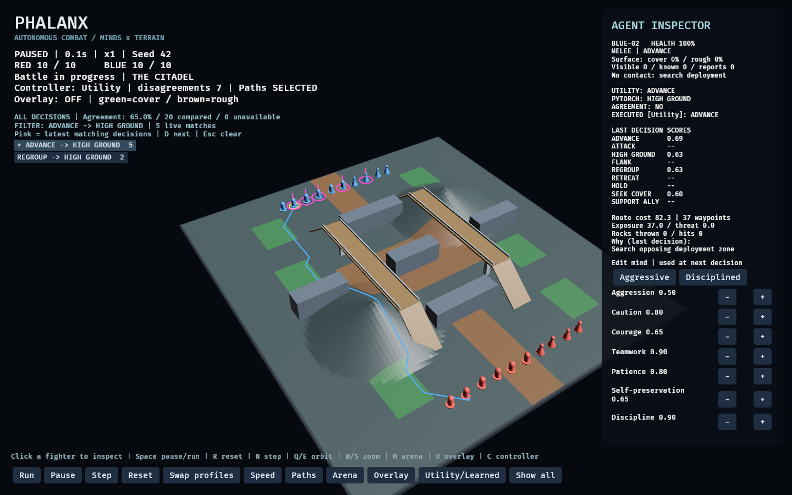
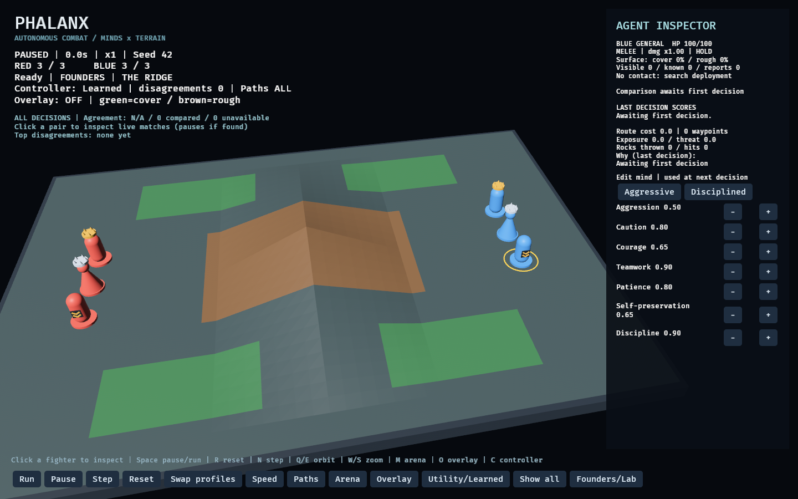
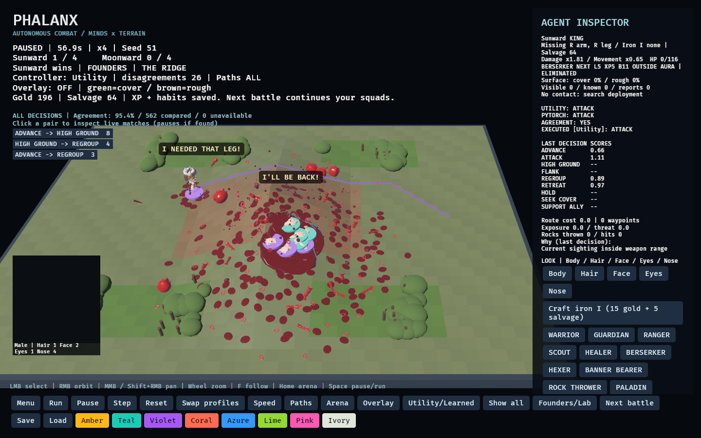
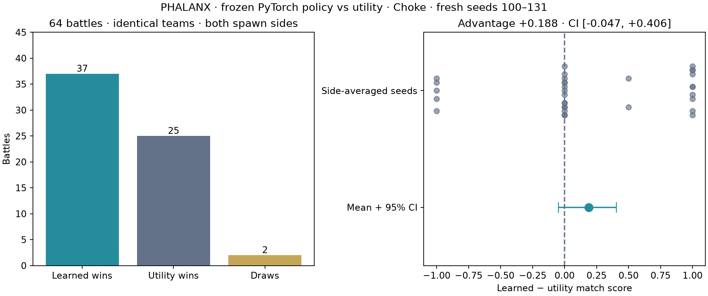

# PHALANX

**Terrain-aware autonomous combat simulation and an experimental testbed for game AI.**

Players shape battlefields and agent personalities, then observe autonomous teams fight. PHALANX explores how terrain, individual psychology, and teamwork affect collective behavior—and how to make those decisions explainable and measurable.

> **Status: early playable prototype.** The default Founders setup starts each team with a King, Queen, and General. The Lab keeps its original 5-versus-5 standard battles and 10-versus-10 Citadel arena, personality-weighted routes, cover, rough ground, seven arena presets, limited perception, shared sightings, ally support, and decision inspection. Python experiments and a trained PyTorch policy are available, with live Utility/Learned control and same-state decision comparison. Arena editing and generative cognition remain planned.



[Live learned-controller gameplay recording](docs/images/learned-demo.gif)

## The first Phalanx

Every starting squad has a **King, Queen, and General**. King and Queen wear basic gold/silver crowns and start at level 1 with **110 HP and +10% damage**; the General starts as a **Paladin**, with a military chevron badge, **100 HP**, and an aura that blesses and motivates nearby allies. Command titles are separate from combat roles: the initial King and General fight in melee, while the Queen throws rocks. Winning still requires eliminating the opposing team; losing royalty does not automatically end a battle.



The squads now persist locally: fighter IDs, minds, classes, XP, battle history, and chosen team colors survive save/load. Completed battles award XP and small battle-conditioned habit changes; **Next battle** continues with the same fighters. [Play the progression loop and see its current limits](docs/progression.md). Recruitment and the wider game follow the [commercial roadmap](PHALANX_COMMERCIAL_GAME_ROADMAP_v0.1.md). **Founders/Lab** switches setups; launch with `--lab` for the original experimental rosters. Both share the same simulation, controllers, telemetry, and inspector.

## Visual combat and wounded veterans

The supplied male/female bases now have derived game-ready rigs with seven basic animation clips. Appearance uses real 3D hair, painted skin textures and an actual on-field camera portrait. Founders can survive limb loss, carry wounds across battles, earn salvage and craft Iron I prosthetics. The first iron arm grants **3× damage with a 15% movement penalty**. Blood sprays, spreading puddles, stylized organ debris and flying body pieces follow actual combat events.



[Asset pipeline, live verification and visual limits](docs/visual-combat.md) · [Wounds and crafting rules](docs/progression.md#wounds-salvage-and-first-crafting-recipe) · [Proposed reserve roster](docs/roster-design.md)

## Local game loop

Start in the main menu, enter the arena, select a fighter, customize its class/mind, then watch autonomous combat. Eight launch classes plus Rock Thrower and Paladin have real mechanics; the General remains a Paladin. Authored event barks and starter painted expressions reflect combat state. Earn gold, retrain for 10 gold, or fit an iron limb for 15 gold + 5 salvage. Save 1,000 gold to recruit the fourth fighter and enter a matched local 4v4 league.

The menu includes the full **3 → 20 gold ladder**, ending at 650,000 gold for slot 20. **Playable leagues currently stop at 4**; later prices are tuning targets. [Economy and complete ladder](docs/economy.md) · [Class mechanics](docs/classes.md). No networking, automatic online discovery or LLM runtime is implemented in this slice.

## Implemented

- Seven 3D arenas: Ridge, Choke, Open Field, Citadel, Highlands, Ruins and Grand Arena; green cover, brown rough ground, and solid choke walls.
- Standard arenas: three melee fighters and two rock throwers per team. Citadel: **six warriors and four rock throwers per team**, on a **44 × 40 footprint (5× the standard area)**, with twin elevated positions, multiple choke passages, barricades, cover, rough ground, and **two walkable raised passerelles with ramps**.
- Visible rocks, travel time, possible misses, and blocked shots.
- Seven editable mind traits and nine scored tactical actions (including seeking cover and supporting allies).
- Run, pause, single-step, reset, profile swap, and x1/x2/x4/x10 speed controls.
- Click selection, decision scores, personality presets, and individual trait adjustments.
- Camera orbit/zoom; actual route, terrain, threat, and elevation overlays.
- Route costs include distance, terrain difficulty, exposure, remembered enemy threat, cover protection, and uphill travel; personality affects the weights.
- Range/line-of-sight perception, fading enemy memory, and nearby cooperative allies sharing direct sightings.
- Ally support, shared target preferences, and flanking incentives when a teammate engages an enemy.
- Knowledge overlay: green current sightings, gold personal memories, purple allied reports; contact age/source and decision reasons in the inspector.
- Smooth display between fixed simulation snapshots, optimized route searches, and optional frame timing diagnostics.
- Fixed-step combat, simultaneous damage, deterministic seeded decision variation, and JSON battle summaries.

Agents follow routes on a one-unit grid, with ally separation, terrain slowdown, and wall clearance. Attacks require a clear segment through the arena. Agent decisions and route danger use their own observed, remembered, or reported contacts. When no contact is known, agents search the authored enemy deployment zone. The player sees the complete arena as an observer; agents do not receive that complete view. Cover is an abstract defensive terrain bonus, not a physical shield.

## Live controller experiment

**Same Choke map, 32 fresh seeds, both spawn sides, identical teams.** The frozen learned policy won 37 battles; utility won 25; two were draws. The learned-minus-utility score was +0.188 (95% seed-block bootstrap interval: −0.047 to +0.406). The interval includes zero, so superiority is not established.



Press **C** or **Utility/Learned** to switch controllers. The inspector compares utility and PyTorch proposals on the same observation, shows agreement and the executed action, and disagreements are logged to JSONL. A tiny live summary shows agreement and the top three Utility → Learned action pairs; battle JSON includes the full count matrix. Utility remains the default, eligibility authority, and fallback. [Protocol, interpretation, limitations, and reproduction](docs/results/v05/README.md).

## First measured results

**864 battles**, three arenas, both spawn orientations, 48 seeds. A 6,665-parameter PyTorch policy reached **97.9% masked action agreement** on held-out seeds (simple attack/advance baseline: 73.1%). This measures imitation of utility AI, not better combat performance.

The trait study found a caution advantage reversal between Ridge and Choke, while higher teamwork underperformed in the tested configuration. We report these results, uncertainty, and limitations in [the measured baseline](docs/results/v04/README.md).

Run experiments or train/reload the model with [the Python/PyTorch guide](analysis/README.md).

## The experience

Build an arena → shape two teams' minds → run a battle → inspect decisions → change one variable → repeat.

Seven personality traits influence tactical utility: aggression, caution, courage, teamwork, patience, self-preservation, and discipline. The inspector exposes candidate action scores and the state behind each decision.

## Research question

**Does selective generative reasoning improve autonomous tactics enough to justify its latency and computational cost?**

The project first establishes deterministic combat and terrain-aware navigation. A later local LLM may propose an action from a validated set when tactical choices are ambiguous. The simulation retains authority over movement, damage, and world state.

## Stack and planned extensions

- **Rust / Bevy 0.19.1:** implemented interactive simulation, tactical pathfinding, combat, and agent inspection.
- **Python:** implemented sequential telemetry collection, counterbalanced experiment batches, seed-block bootstrap intervals, and standalone plots.
- **Optional local LLM:** structured tactical proposals, legality validation, deterministic fallback.
- **PyTorch:** a trained, reload-verified imitation policy with disjoint training/validation/test seeds; held-out evaluation, simple baselines, and live controller comparison.

The live game runs the exported trained weights through an equivalent Rust CPU forward pass verified against PyTorch. No generative model has been integrated.

## Milestones and acceptance criteria

| Milestone | Deliverable | Evidence required |
| --- | --- | --- |
| 1 — Make it alive | 3D arena, 5 vs 5, utility AI, run/pause/reset, clickable inspector | A recorded demo showing personality changes affecting decisions |
| 2 — Make terrain matter | Cover, elevation, terrain costs, tactical paths, arena presets | Controlled demonstrations on ridge, choke, and open-field maps |
| 3 — Make behavior measurable | Seeded batches, JSON telemetry, Python analysis | Reproducible comparisons with uncertainty and limitations |
| 4 — Evaluate generative cognition | Selective LLM proposals, validation, fallback | Baseline comparison including quality, latency, and cost |

## Evaluation approach

Compare simple heuristics, utility AI, and utility AI with selective LLM reasoning on matched maps and seeds. Swap team spawn sides to reduce positional bias. Record outcomes and decision sequences; treat battles as the experimental unit rather than treating every tick as independent evidence.

Measure win rate, survival, cohesion, cover use, action validity, decision latency, and LLM calls/tokens. Predefine success criteria, report confidence intervals, and separate exploratory observations from held-out evaluations. Human playtests should assess readability and player experience separately from combat performance.

See [the evaluation protocol](docs/evaluation.md) and [the full design brief](docs/design-brief.md).

## Relevance to interactive AI research

PHALANX is designed to connect game-design questions to measurable system behavior: translate a design need into an experiment, expose agent decisions, analyze sequential data, and evaluate whether a generative component helps the experience. It is an independent portfolio project, with no Ubisoft affiliation.

## Running the project

Install a current stable Rust toolchain, then:

```bash
cargo run --locked --bin phalanx
```

On Linux, Bevy requires graphical drivers and development libraries for the window/input stack. On Debian/Ubuntu, install `build-essential pkg-config libudev-dev libwayland-dev libxkbcommon-dev libx11-dev libxi-dev libxrandr-dev`.

Click **Run**. Click a fighter to inspect it, then use the presets or trait buttons to change its mind. **Swap profiles** resets the battle with the teams' psychological profiles exchanged. **Reset** restores the original profiles for the current orientation and seed, including discarding individual edits.

**Arena** cycles Ridge → Choke → Open Field → Citadel and resets the battle. **Overlay** cycles Off → Terrain → Threat → Elevation → Knowledge. Threat uses the selected unit’s known contacts; the knowledge view marks last-observed positions, including stale ones.

Keyboard: **Space** run/pause, **R** reset, **N** single-step, **Tab** cycle units, **Q/E** orbit, **W/S** zoom, **M** arena, **O** overlay, **C** Utility/Learned controller, **D** next filtered match, **Esc** menu. Mouse: **RMB** orbit, **MMB / Shift+RMB** pan, **wheel** zoom, **F** follow selected fighter, **Home** frame arena.

**Paths** cycles All → Selected → Off; Citadel starts with only the selected route to keep a 20-agent battle readable.

Click a top disagreement pair to filter living agents by their latest Utility → Learned proposals. Matching agents glow pink; a live match pauses and opens its inspector. **D** cycles matches, and **Show all / Esc** clears the filter. Historical counts can remain high while there are zero live matches.

Launch the larger map with `cargo run --locked --bin phalanx -- --arena citadel`. The frozen learned policy was trained on the three smaller arenas; Citadel control is exploratory and its feature distribution differs from training.

Add `--learned` to start with learned control. Disagreement logs are written to `outputs/disagreements-*.jsonl`.

You can also launch a specific setup: `cargo run --locked --bin phalanx -- --lab --arena choke --seed 42`.

Headless execution needs no graphics dependencies:

```bash
cargo run --locked --no-default-features --bin phalanx-batch -- --arena ridge --seed 42 --output battle.json
cargo run --locked --no-default-features --bin phalanx-batch -- --arena choke --seed 42 --swap --output swapped.json
cargo test --locked --no-default-features
```

The JSON contains arena, roles, final unit state, traits, decision counts, damage, movement distance, route cost components, cover/rough-ground ticks, rocks thrown, target-hit counts, contact memory/provenance, shared-report updates, and support/flank decisions. A rock can hit several enemies within its impact radius, so target-hit counts can exceed rocks thrown. Optional `--trace FILE.jsonl` records decision-time features, eligible actions, observations, decisions, and damage events. The analysis package consumes real simulation records. Reproducibility applies to the same build/configuration; cross-platform floating-point equivalence is not guaranteed.

See [implementation and validation notes](docs/prototype.md) and [local performance measurements](docs/performance.md).

For timing diagnostics:

```bash
cargo run --locked --no-default-features --example profile
RUST_LOG=info cargo run --locked --bin phalanx -- --arena choke --profile
```

## Author

Guillaume Heinerth · [GitHub](https://github.com/Fiendstar77)

> Do not command the phalanx. Build the minds and terrain from which the phalanx emerges.
