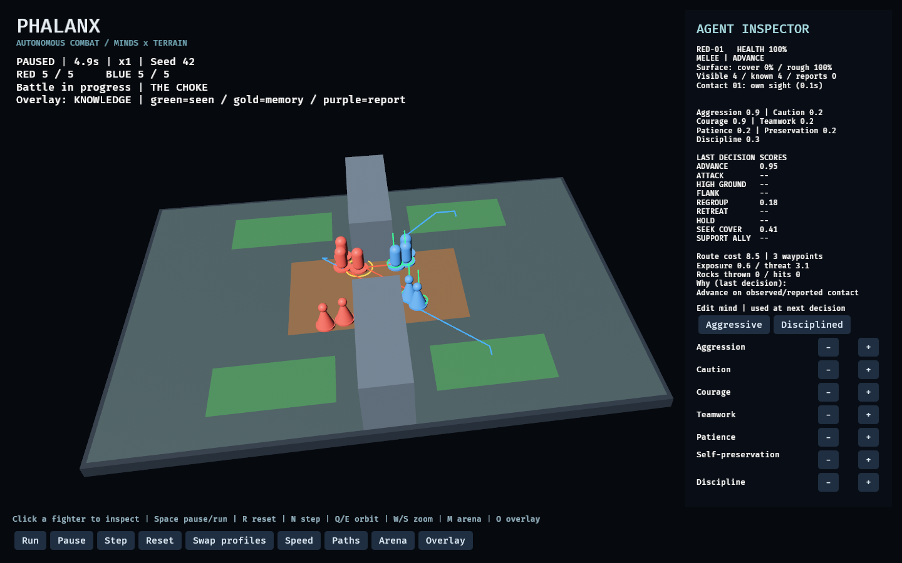

# PHALANX

**Terrain-aware autonomous combat simulation and an experimental testbed for game AI.**

Players shape battlefields and agent personalities, then observe autonomous teams fight. PHALANX explores how terrain, individual psychology, and teamwork affect collective behavior—and how to make those decisions explainable and measurable.

> **Status: early playable prototype.** Rust/Bevy runs 5-versus-5 battles with three melee fighters and two rock throwers per team, personality-weighted routes, cover, rough ground, three arena presets, limited perception, shared sightings, ally support, and decision inspection. Python analysis, arena editing, and generative cognition remain planned. No model has been trained or integrated.



[Terrain and rock-throwing gameplay recording (v0.2)](docs/images/demo.gif)

## Implemented

- Three 3D arenas: Ridge, Choke, and Open Field; green cover, brown rough ground, and solid choke walls.
- Three melee fighters and two rock throwers per team, with visible rocks, travel time, possible misses, and blocked shots.
- Seven editable mind traits and nine scored tactical actions (including seeking cover and supporting allies).
- Run, pause, single-step, reset, profile swap, and x1/x2/x4/x10 speed controls.
- Click selection, decision scores, personality presets, and individual trait adjustments.
- Camera orbit/zoom; actual route, terrain, threat, and elevation overlays.
- Route costs include distance, terrain difficulty, exposure, remembered enemy threat, cover protection, and uphill travel; personality affects the weights.
- Range/line-of-sight perception, fading enemy memory, and nearby cooperative allies sharing direct sightings.
- Ally support, shared target preferences, and flanking incentives when a teammate engages an enemy.
- Knowledge overlay: green current sightings, gold personal memories, purple allied reports; contact age/source and decision reasons in the inspector.
- Smooth display between fixed simulation snapshots, optimized route searches, and optional frame timing diagnostics.
- Fixed-step combat, simultaneous damage, deterministic seeded decision variation, and JSON battle summaries.

Agents follow routes on a one-unit grid, with ally separation, terrain slowdown, and wall clearance. Attacks require a clear segment through the arena. Agent decisions and route danger use their own observed, remembered, or reported contacts. When no contact is known, agents search the authored enemy deployment zone. The player sees the complete arena as an observer; agents do not receive that complete view. Cover is an abstract defensive terrain bonus, not a physical shield.

## The experience

Build an arena → shape two teams' minds → run a battle → inspect decisions → change one variable → repeat.

Seven personality traits influence tactical utility: aggression, caution, courage, teamwork, patience, self-preservation, and discipline. The inspector exposes candidate action scores and the state behind each decision.

## Research question

**Does selective generative reasoning improve autonomous tactics enough to justify its latency and computational cost?**

The project first establishes deterministic combat and terrain-aware navigation. A later local LLM may propose an action from a validated set when tactical choices are ambiguous. The simulation retains authority over movement, damage, and world state.

## Stack and planned extensions

- **Rust / Bevy 0.19.1:** implemented interactive simulation, tactical pathfinding, combat, and agent inspection.
- **Python (planned):** sequential telemetry analysis, statistical comparisons, and experiment reporting.
- **Optional local LLM:** structured tactical proposals, legality validation, deterministic fallback.
- **PyTorch:** a later learned-policy baseline or training experiment, only once real simulation data and an evaluation pipeline exist.

No model has been trained or integrated at this stage.

## Milestones and acceptance criteria

| Milestone | Deliverable | Evidence required |
| --- | --- | --- |
| 1 — Make it alive | 3D arena, 5 vs 5, utility AI, run/pause/reset, clickable inspector | A recorded demo showing personality changes affecting decisions |
| 2 — Make terrain matter | Cover, elevation, terrain costs, tactical paths, arena presets | Controlled demonstrations on ridge, choke, and open-field maps |
| 3 — Make behavior measurable | Seeded batches, JSON telemetry, Python analysis | Reproducible comparisons with uncertainty and limitations |
| 4 — Evaluate generative cognition | Selective LLM proposals, validation, fallback | Baseline comparison including quality, latency, and cost |

## Evaluation approach

Compare simple heuristics, utility AI, and utility AI with selective LLM reasoning on matched maps and seeds. Swap team spawn sides to reduce positional bias. Record outcomes and decision sequences; treat battles as the experimental unit rather than treating every tick as independent evidence.

Measure win rate, survival, cohesion, cover use, action validity, decision latency, and LLM calls/tokens. Predefine success criteria, report confidence intervals, and separate exploratory observations from held-out evaluations. Human playtests should assess readability and player experience separately from combat performance.

See [the evaluation protocol](docs/evaluation.md) and [the full design brief](docs/design-brief.md).

## Relevance to interactive AI research

PHALANX is designed to connect game-design questions to measurable system behavior: translate a design need into an experiment, expose agent decisions, analyze sequential data, and evaluate whether a generative component helps the experience. It is an independent portfolio project, with no Ubisoft affiliation.

## Running the project

Install a current stable Rust toolchain, then:

```bash
cargo run --locked --bin phalanx
```

On Linux, Bevy requires graphical drivers and development libraries for the window/input stack. On Debian/Ubuntu, install `build-essential pkg-config libudev-dev libwayland-dev libxkbcommon-dev libx11-dev libxi-dev libxrandr-dev`.

Click **Run**. Click a fighter to inspect it, then use the presets or trait buttons to change its mind. **Swap profiles** resets the battle with the teams' psychological profiles exchanged. **Reset** restores the original profiles for the current orientation and seed, including discarding individual edits.

**Arena** cycles Ridge → Choke → Open Field and resets the battle. **Overlay** cycles Off → Terrain → Threat → Elevation → Knowledge. Threat uses the selected unit’s known contacts; the knowledge view marks last-observed positions, including stale ones.

Keyboard: **Space** run/pause, **R** reset, **N** single-step, **Tab** cycle units, **Q/E** orbit, **W/S** zoom, **M** arena, **O** overlay.

You can also launch a specific setup: `cargo run --locked --bin phalanx -- --arena choke --seed 42`.

Headless execution needs no graphics dependencies:

```bash
cargo run --locked --no-default-features --bin phalanx-batch -- --arena ridge --seed 42 --output battle.json
cargo run --locked --no-default-features --bin phalanx-batch -- --arena choke --seed 42 --swap --output swapped.json
cargo test --locked --no-default-features
```

The JSON contains arena, roles, final unit state, traits, decision counts, damage, movement distance, route cost components, cover/rough-ground ticks, rocks thrown, target-hit counts, contact memory/provenance, shared-report updates, and support/flank decisions. A rock can hit several enemies within its impact radius, so target-hit counts can exceed rocks thrown. It is an initial summary format; sequential decision logging and Python analysis remain future work. Reproducibility applies to the same build/configuration; cross-platform floating-point equivalence is not guaranteed.

See [implementation and validation notes](docs/prototype.md) and [local performance measurements](docs/performance.md).

For timing diagnostics:

```bash
cargo run --locked --no-default-features --example profile
RUST_LOG=info cargo run --locked --bin phalanx -- --arena choke --profile
```

## Author

Guillaume Heinerth · [GitHub](https://github.com/Fiendstar77)

> Do not command the phalanx. Build the minds and terrain from which the phalanx emerges.
