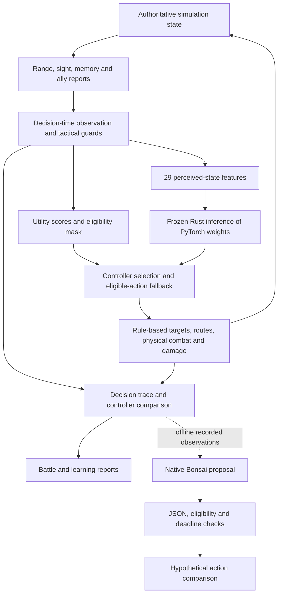
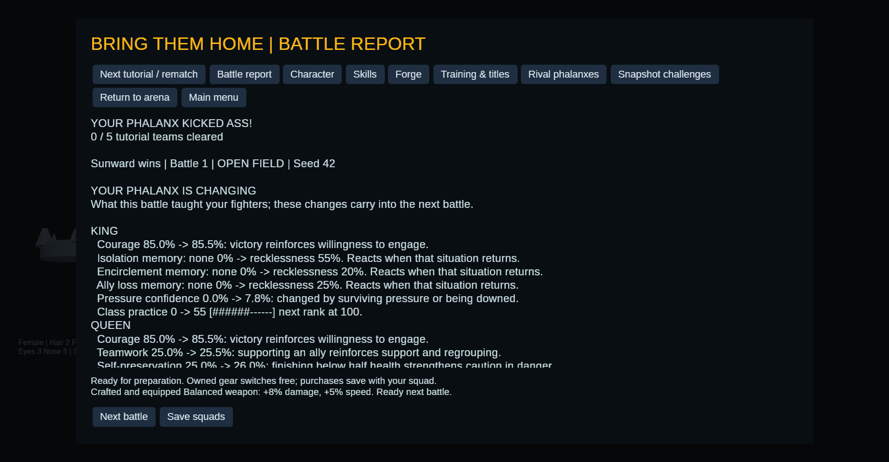

# Inspect the AI engineering

Phalanx combines a playable autonomous combat environment with an inspectable
AI experiment pipeline. The work connects observation design, tactical planning,
supervised learning, native inference, persistent adaptation, simulation tools
and evaluation. Each controller operates against explicit interfaces; the
repository retains the evidence needed to question its behavior.

Start with the architecture below, then inspect the [measured results](#measured-results).
For implementation review, use the [code and test walkthrough](code-review.md).
The [latest evidence bundle](../results/v06/README.md) can be read entirely on
GitHub, without installing the game, PyTorch or Bonsai.

## What runs today

| Layer | Implementation | Deployment and authority |
| --- | --- | --- |
| Perception and coordination | Occlusion/range checks, decaying contact memory, bounded ally reports, focus/support/flank rules | Live game; agents act on contacts rather than arbitrary hidden enemy transforms |
| Utility controller | Nine guarded tactical objectives, personality and situational scores, seeded variation | Live default, action eligibility authority and deterministic fallback |
| Learned controller | PyTorch-trained 29 → 64 → 64 → 9 ReLU policy; 6,665 parameters | Frozen exported weights run in Rust and can control live combat |
| Campaign adaptation | Experience, class/weapon practice, conditioned reactions, habit updates and rival counters | Persists through save/load and influences later battles; uses authored rules |
| Bonsai 1.7B | Local native `libllama` inference; structured action proposals and combat text | Separate experiments; tactical shadow decisions do not alter a battle |
| Study tooling | JSONL observations/receipts, battle state, readable reports, manifests and checks | Inspects behavior and provenance; does not choose combat outcomes |

The distinction between campaign adaptation, supervised training and generative
inference is deliberate. The campaign changes its persisted state during play.
The bundled neural policy and Bonsai weights do not train during play.

## Architecture

The last branch ends in a comparison report. It does not feed the live action
selector. Presentation reads actual simulation state and events; generated
language has no damage, targeting, inventory or reward authority.

### Partial observations and team information

[Perception](../../src/perception.rs) records contacts with a position, last-seen
tick, source and visibility flag. Terrain and range determine direct sight.
Cooperative nearby allies can relay sightings, but receiving a report does not
grant direct line of sight. Old contacts lose confidence and expire rather than
being refreshed by repeated relays.

[Coordination](../../src/cognition.rs) scores known targets using distance,
confidence, visible status, allied focus and personality. Support responds to
known pressure/injury; flanking requires an engaged ally and a valid opportunity.
These are authored multi-agent rules, not a learned communication protocol.
The [perception tests](../../tests/perception_and_coordination.rs) include a
counterfactual check: moving an unseen enemy must not change the tested agent's
decision or route. This supports the checked tactical boundary; it does not
assert that every campaign psychology counter is observation-limited.

[Navigation](../../src/navigation.rs) uses a weighted shortest-path search on a
walkability graph. Its decomposed cost includes distance, rough terrain,
exposure, remembered threat and climbing. Caution, self-preservation and patience
change those costs. Consequently two fighters with the same objective can take
different routes, and a route's cost can be inspected instead of inferred from
the animation.

### One action interface for different controllers

The [simulation decision loop](../../src/lib.rs) scores nine tactical actions:
advance, attack, high ground, flank, regroup, retreat, hold, seek cover and support
ally. A negative score marks an ineligible objective. The utility proposal is
the highest score; the learned controller sees the observation features and
the same eligibility mask. Missing or unusable learned predictions select the
utility proposal.

The simulation advances at a fixed 0.1-second timestep and evaluates tactical
choices every five ticks. The selected action is an objective. Existing rules
still determine its target, route, weapon timing and physical result. The
[telemetry contract](../../src/telemetry.rs) records the observation at the
decision phase, before movement, so comparisons do not accidentally use the
state resulting from the choice.

## Supervised learning and deployment

The [training pipeline](../../analysis/train.py) learns to imitate eligible
utility choices. This is an inspectable teacher baseline, not reward-driven
reinforcement learning. It provides a controlled way to test data collection,
preprocessing, model selection, deployment and behavioral divergence.

- Whole seeds are separated into training 0–31, validation 32–39 and test 40–47.
  Maps, studies and spawn orientations for a seed stay in the same split.
- Normalization uses training observations only. Inputs exclude utility-score
  magnitudes, chosen labels, future state and hidden enemy transforms.
- A ReLU MLP is trained with masked logits, class-weighted cross entropy and
  AdamW. Validation supported-class macro-F1 selects the checkpoint; held-out
  evaluation follows selection.
- [Export](../../analysis/export.py) stores actual tensors, normalization,
  feature/action ordering and the checkpoint SHA-256 in a portable JSON schema.
- [Rust inference](../../src/learned.rs) validates that schema and dimensions,
  rejects nonfinite input, performs normalization and the forward pass, then
  chooses among eligible actions. No Python process runs on the gameplay thread.

The runtime's schema-two loader supports other bounded layer sizes. The shipped
policy remains the 6,665-parameter v0.4 checkpoint. Support for a larger model
configuration is not evidence that a larger model is the deployed controller.

The [cross-language witness test](../../tests/learned.rs) compares Rust logits
against actual PyTorch outputs on 32 held-out observations with an absolute
tolerance of 0.0002, then compares masked action choices. Other tests exercise
replay, unavailable-policy fallback and shadow comparison without changing the
utility rollout. Masked softmax confidence is not calibrated certainty.

## What learning means to the player

[Campaign settlement](../../src/progression.rs) preserves fighter identity and
updates experience, practice, personality habits and psychological responses.
For example, supporting an ally reinforces teamwork; finishing below half health
increases self-preservation. Exposure to isolation or encirclement conditions
reactions according to the fighter's personality. A later matching situation
can bias the fighter's utility scores through [psyche rules](../../src/psyche.rs).

The same event can produce fear or recklessness in different fighters.
Adaptation is not guaranteed improvement, and the current rule changes are not
online neural training. XP/stat growth, changed tactical preferences and
conditioned reactions are separate mechanisms.

[Learning receipts](../../src/learning.rs) record actual before/after values.
The post-battle screen exposes them with practice progress and rank-ups, and
the report files preserve them for analysis. The [study tests](../../tests/study.rs)
verify that these values survive save/load and appear in the next battle. The
[psychology tests](../../tests/progression.rs) separately check that contrasting
conditioned reactions change the same decision.

The campaign begins at 3v3 and currently supports progression to 4v4. Five NPC
tutorial teams are sequential opponents. Historical Lab experiments use their
own explicitly documented 5v5/10v10 configurations.

## Native generative inference

[Bonsai's runner](../../tools/bonsai_smoke.py) loads a local GGUF through native
shared libraries, with four CPU threads, zero GPU layers and greedy sampling.
It requires no inference server. Its source/runtime/model hashes and settings
are retained with the study. Model weights and runtime binaries are local
dependencies, not included in this repository.

The [tactical contract](../../tools/bonsai_tactics.py) sends an allowlisted
observation of the same 29 features plus eligible action names. Feature values
are rounded to five decimal places. Reference choices, score magnitudes,
targets, hidden state and future events are withheld. Bonsai also receives
natural-language action descriptions; this is a same-state comparison, not a
claim of identical input representations across architectures.

Only a one-key JSON object such as `{"action":"SEEK COVER"}` is accepted.
Malformed JSON, duplicate keys, extra fields, unknown/ineligible actions,
runtime failure, timeout or a missed deadline select the recorded utility
fallback. The runner retains the raw response rather than silently repairing it.
Accepted decisions are hypothetical: the recorded battle has already run.

This isolates questions worth investigating before gameplay integration:
Can the model obey the interface? Where does it disagree? What fails under a
deadline? What resident-worker latency is achievable? Does executing its choices
improve a predefined outcome? The current evidence answers the first questions
only. It does not establish stronger play or justify blocking a simulation tick.

## Measured results

| Evidence | Observed result | Interpretation |
| --- | --- | --- |
| [v0.4 collection and held-out imitation](../results/v04/README.md) | 864 battles; 97.91% masked teacher agreement versus 73.06% simple baseline; supported macro-F1 0.932 | Historical training result; imitation of that utility policy, not combat superiority |
| [v0.5 controlled Choke duel](../results/v05/README.md) | 64 battles, 32 seed blocks; learned wins 37, utility wins 25, draws 2; score advantage +0.1875, 95% interval [−0.046875, +0.40625] | Interval includes zero; superiority is not established |
| [v0.6 campaign study](../results/v06/campaign/report.md) | Three persisted 3v3 battles; player King's class practice 0 → 35 → 70 → 125 | Demonstrates accumulated state and a rank threshold; does not isolate an effect on wins |
| [v0.6 Bonsai offline study](../results/v06/tactical/report.md) | 12/12 accepted proposals with a 10-second budget; mean request time about 2.75 seconds including loading | Small, correlated shadow sample; not live control or a win-rate experiment |
| [v0.6 deadline probe](../results/v06/deadline/report.md) | 0/3 accepted at 1.5 seconds; all select utility fallback | Retained failure evidence; the process-per-request setup misses this budget |

The v0.4 model's raw unmasked eligibility was only 53.89%. Its valid masked
choices are guaranteed by the interface, not learned legality. The older
single-observation PyTorch timing and the native Bonsai request timing measure
different scopes and must not be read as an architecture speed comparison.

Historical estimates belong to their captured simulator commits. Re-running
current combat rules creates a new experiment. Seed blocks preserve paired
spawn orientations for uncertainty; thousands of decisions in one battle are
not thousands of independent trials.

## Inspect or reproduce

1. Open the [v0.6 evidence index](../results/v06/README.md) and its
   [decoded observations and raw completions](../results/v06/tactical/observations.json).
2. Follow a claim to its source and test in the [review map](code-review.md).
3. Run `python3 tools/check_ai_evidence.py` to check published hashes and
   cross-artifact consistency with no model download.
4. Use the [study commands](../ai-studies.md) to generate a new campaign report,
   or the [training guide](../../analysis/README.md) for supervised experiments.
5. Install the optional [native prerequisites](../bonsai.md) to reproduce Bonsai
   probes. Absolute latency depends on the machine and process/model loading.

Future work is a resident asynchronous worker, explicit call/latency budgets,
controlled rollouts where LLM proposals actually execute, and separate player
tests of visible adaptation and decision readability. None is represented by
the current shadow study's acceptance rate.
