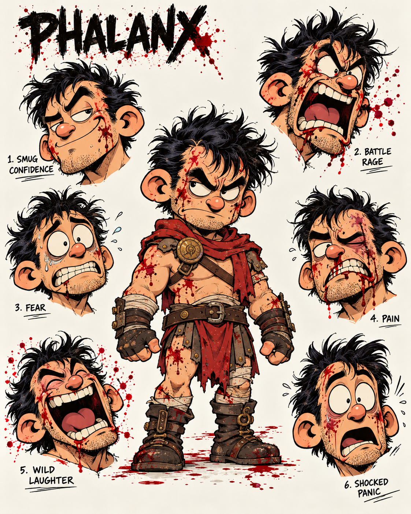
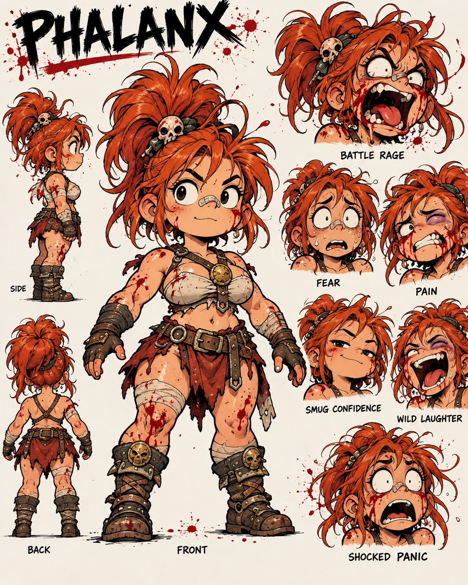

# Character direction

User-supplied visual targets, October 15, 2026. These are art references, not
in-game sprites and not proof that the 3D models match them.

- Round, appealing face silhouettes; short noses; large white eyeballs.
- Strong arched brows and a lopsided, self-assured resting expression.
- Extreme rage, fear, pain, laughter and panic: jaw travel, visible teeth,
  tongue, eye squash and asymmetry, rather than an expression painted over skin.
- Chunky boots and gloves, wrapped cloth, worn leather, broad belts and
  layered pieces. Class silhouettes must read at battle-camera distance.
- A contrast between charming characters and slapstick battlefield gore.

The runtime now uses the new artist-rigged bases with fitted eyes; older experimental heads have been removed. See [the model pipeline](rigged-base-eyes.md).

The first equipment pass uses body-fitted skinned cloth surfaces and authored
bone-mounted starter weapons. Fine sculpting, cloth folds, textures and the
hair silhouettes in these sheets remain further art work.

[Eight core class previews](class-previews.md) show the current palette and weapon pass.
