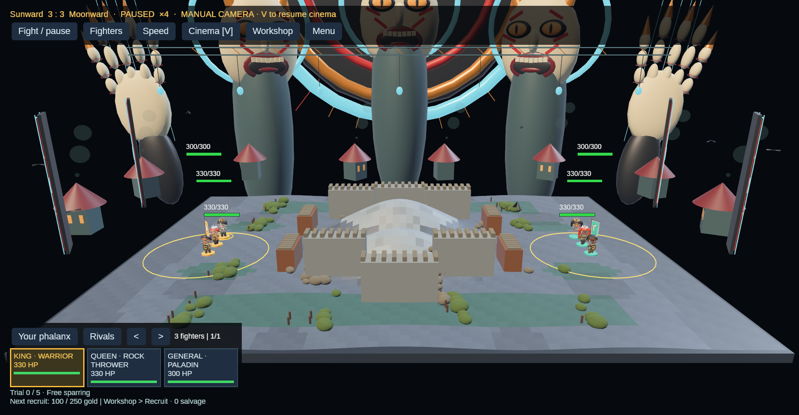
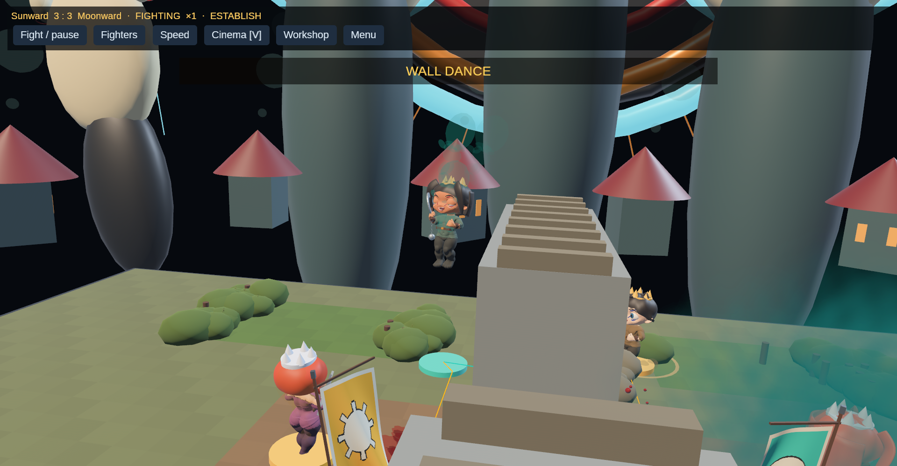
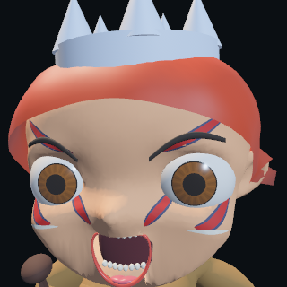
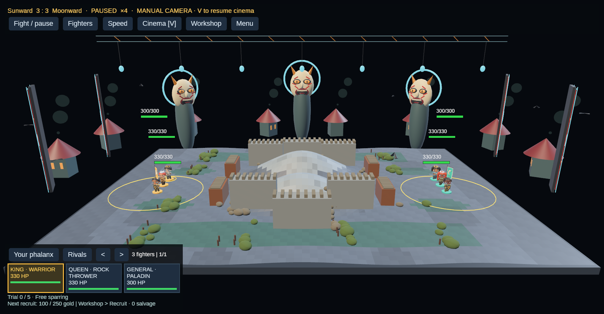
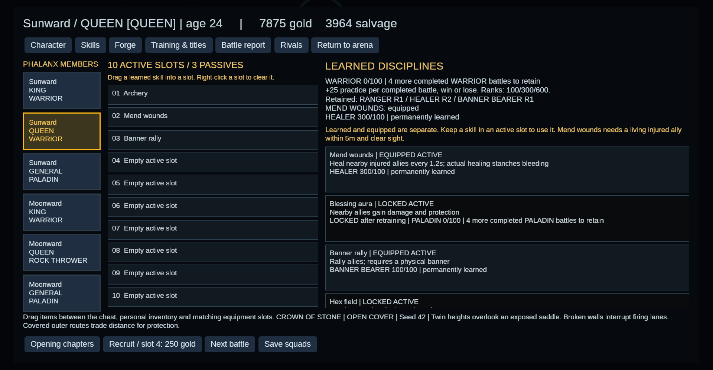
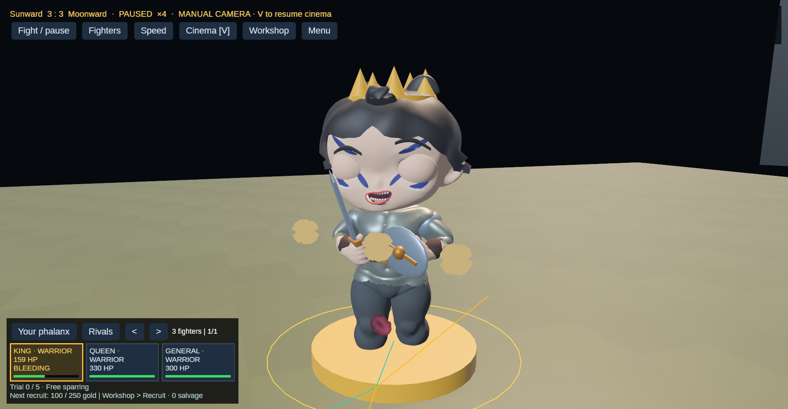

# The Kabuki Yard: first visual pass

Author direction: make the visuals startling, with Kabuki as the reference.
This is a first implemented art pass, not a finished production style.

Fun comes first. The adult, bizarre theatre gives the game a distinct voice;
experimentation, readable consequences and attachment to persistent fighters
must earn the return visit. Judge this pass in play: can the patron understand
the healing requirement, read the fight through the spectacle, and find a new
combination worth trying? Commercial appeal and lasting attachment need player
evidence; neither follows automatically from shocking imagery.

The reference is bold painted anatomy and theatrical exaggeration. The
[Japan Arts Council's kumadori guide](https://www2.ntj.jac.go.jp/dglib/contents/learn/edc25/en/kumadori-makeup/index.html)
provides the makeup reference. These are original inspired designs, not
reproductions of a named traditional role or a claim of historical accuracy.

## Faces

Crimson strokes, indigo edges and ivory accents sit on the artist's actual
sculpt. Each painted patch carries the same seventeen expression and identity
controls as the face. It is separate from skin tint, so choosing a complexion
does not erase the makeup. Saved face presets select crimson, indigo, ember or
plum paint. Smooth ribbons follow the surface instead of triangle-shaped paint
patches. The source body and eyed rigs are preserved.

The mouth has full upper/lower lip volumes, a central upper-lip dip, a separate
vermilion material, curved rows of rounded teeth, and a broader tongue with a
groove and shaped tip. Tongue shapes follow grin, pain and shout. Bark-driven
mouth opening varies on the actor clock; this is articulation, not phoneme sync.
Pause preserves the actor clock. None of these changes affects capability.

## Fifteen wall performances

The runtime now has 82 clips per body. The wall family contains the original
WallKickStrike plus Tight Tuck, Scissor, Sidewinder, Back Arch, Heel Lead,
Corkscrew, Cross Guard, Long Split, Knee Drive, Shoulder Turn, Double Tuck,
Crane, Reverse Twist and Scramble. These alter torso, arm and leg choreography;
they do not grant fifteen traversal powers.

The live selector first restricts the bank by temperament, wounds, health,
missing arms and ranged equipment. Persistent fighter identity and the real
leap's start tick choose a variation within that bank. Repetition is possible.
Playback uses that leap's actual start
and end, so a variation cannot invent extra travel time. Every export keeps the
local hip displacement below five centimetres; the physical leap supplies the
height. The motion validator also checks pairwise joint-angle separation at
four times, rejecting renamed or nearly identical clips.

Current temperament now selects composed, fierce, watchful or anxious delivery
for idle, gait and ordinary strike clips. This is a presentation interpretation
of the existing mind, not a replacement for Origin, learned practice or event
memories. Wounds and legal traversal retain priority. The Lab baseline remains.

Sixteen additional clips cover scanning, low survey, listening, shoulder checks,
advance/hold signals, weapon readiness, watch shifts, left/right arm guarding,
left/right limping, torso hunching, wound flinches, exhausted bracing and relief
breathing. Reconnaissance state, actual contact reports, wound region, effort
and real healing receipts select these responses. This is a bounded authored
repertoire, not a complete personality animation system.

Region-based ragged flesh lesions become thin scars as the actual injury
recovers. They attach to skin joints; this is surface geometry rather than
volumetric tissue cutting. [Rules, persistence and tactical consequences](../patient-tactics-and-wounds.md).

## The watching Yard

Three monumental painted effigies frame the current battlefield. Their slit
pupils follow the fight's average living position and widen briefly after a
real damage receipt. Slow motion in the effigies and halos, roof smoke, circling
birds and wind-driven reeds keep the scene moving. The ambient clock continues
while combat is paused; the fighters' expression clock remains paused.

Lacquer-red scenic wings pivot open when a new bout is staged. A suspended
mechanical truss carries electric-cyan strips and lanterns behind the field.
The current battlefield remains stationary and authoritative throughout the
reveal. Sustained injury pressure gradually warms the key light and shifts the
scenic emission; the interpolation takes seconds. There are no added strobes
or full-screen damage flashes. This is the first neo-cyber stagecraft pass.

The effigies and lantern houses remain outside legal ground. Reeds occupy
existing cover, never a blocked passage or bridge. These are scenic ornaments,
not autonomous citizens, destructible buildings or persistent world geography.
The bounded scene is allocated once and repositioned for the current arena.
Presentation consumes no tactical random draws or mutable Battle access.

## Wire action and colossal ink

The next presentation pass pushes the Hong Kong wire-action reference through
real aerial movement and much larger stage geometry. The three masks are now
2.8 times their original scale. Two articulated porcelain hands, crimson finger
rings, gold claws and suspended cables frame the arena. Behind them, an enormous
rotating celestial machine spans roughly fifty metres including its radial
markers. These remain decorative stage machinery outside legal ground.

During real vaults, launch arcs and burst steps, short-lived team-coloured ink
silhouettes sample sixteen actual skeletal joint transforms. Eleven simplified
body segments preserve the captured pose and head orientation. These are pose
echoes, not duplicates of the full skinned/morphed body. Missing natural limbs
are omitted; substituted limbs can still leave a silhouette. The pool holds at
most twenty-four echoes, fading over 0.36 simulation seconds. Both supplied GLB
exports are checked against the joint-binding contract, including Mixamo names.

Resolved melee damage of at least six percent maximum health, or a severing hit,
can produce broken brush circles, rising ink shards and offset pressure rings.
The presentation admits at most one new impact burst every six simulation ticks,
keeps eight bursts, and retires each after 1.05 seconds. The maximum graphic
radius is 11.5 metres. These are graphic strokes: their reach supplies no extra
damage, collision, terrain destruction or historical accomplishment. Misses and
ranged hits cannot trigger this melee effect.

Automatic cinema compresses toward the contact of a ten-percent-or-greater
melee hit, then pulls back to reveal its aftermath. Actual aerial height adds a
small camera bank, capped near five degrees. Manual and tactical camera modes
retain patron control. No simulation time stretching, extra hang time, bonus
launch height, full-screen flash or new gameplay power is introduced.

The deliberate scouting opening remains. Its quieter periods give these rare
bursts contrast. The current work is a visual prototype; natural spectacle
frequency, readability and sustained performance still need player evaluation.





[Wire-action combat review](../media/colossal-wire-action.mp4). The serial seed-42
ninja effects fixture recorded three legal wall traversals, fifteen admitted ink
bursts, ninety-six captured pose echoes and a peak of eleven simultaneous echoes.
The largest observed graphic radius was 6.31 metres. The fixture stages loadouts,
starting positions and prepared tactics, as described in the ninja guide; combat
resolves normally. It exports 547 screenshots, encoded here at 24 frames/second.
This is a captured review, not a runtime performance benchmark or human playtest.

Current local checks: 75 graphics tests, 14 focused Theus/ninjutsu tests, strict
headless Clippy, formatting and whitespace checks. The new coverage verifies
real-hit effect admission, once-only receipts, paused effect age, unchanged
combat state, effect bounds and both actual GLB joint sets. Serial graphics
reviews completed without changing the current player save. No hosted CI ran.

The next art work includes stronger silhouettes, authored held poses, stage
transitions and richer painted surfaces. The persistent world and journeys
remain the separate project described in the world-and-learning design.

## Healing clarity

The skill page now distinguishes temporary access, permanent learning and
equipped slots. It shows practice and the remaining completed battles required
to retain each discipline. Mend wounds also states its actual prerequisites:
a living injured ally within five units and clear sight. Healing does not
restore severed limbs. Retraining preserves incomplete practice; 100 Healer
practice retains healing, and a learned skill still needs an active slot.

Every completed campaign bout grants 25 active-discipline practice, regardless
of result. The requirement therefore takes four completed Healer bouts from
zero. Theus Medicine practice is a separate track earned by actual use.

## Reproduce the visual review

Use disposable directories with an `assets` symlink to this checkout. Run each
witness serially, after closing any previous PHALANX process:

```bash
PHALANX_FACE_POSE=shout PHALANX_WITNESS_CLOSE=1 /path/to/phalanx --visual-witness --face-witness --seed 42
/path/to/phalanx --visual-witness --yard-witness --seed 42
/path/to/phalanx --visual-witness --flesh-witness --seed 42
/path/to/phalanx --visual-witness --rpg-witness --skills-witness --seed 42
```

These are staged art/UI reviews. They do not measure player attachment,
authentic traditional performance, natural combat frequency or a living world.

## Local review evidence









[Rendered combat excerpt](../media/neo-kabuki-traversal.mp4): the latest scripted
seed-42 effects fixture recorded three wall traversals, twelve smoke deployments
and both team smoke colours across 563 captured frames. Combat resolved normally;
the loadouts, starting positions, prepared phase and scout attributes were staged.

The local evidence and verification commands are recorded in
[patient tactics and wounds](../patient-tactics-and-wounds.md). All fifteen wall
performances are checked for local offsets and pairwise pose differences;
the sixteen new living clips are checked for grounded feet. Rendered reviews
are staged fixtures, including the wound review, which selects the first actual
seeded cutting wound and isolates the injured model for visibility.
The current player save remained unchanged during this serial review. Its
latest progress was preserved, including a battle completed after the original
review baseline had been captured.

Optional strict graphics Clippy still reports lint debt across the existing
graphics modules; that check is not reported as green. No hosted CI was run.
