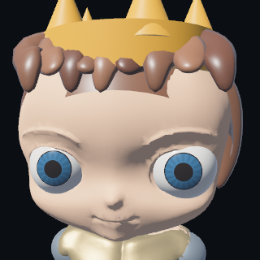
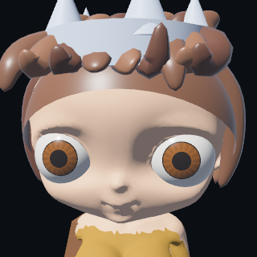

# Eyes for the artist's new rigged bases

`tools/fit_rigged_eyes.py` preserves `assets/characters/phalanx_base_male.glb`
and `phalanx_female_base.glb`, producing `male-eyed.blend`, `male-eyed.glb`,
`female-eyed.blend`, and `female-eyed.glb` in the same directory.

Each model has separate warm ivory eyeballs, curved hazel irises and pupils.
`Eye_L` and `Eye_R` bones are parented to `mixamorigHead`; rotate those bones
in Pose Mode to aim the eyes. The iris moves with its eyeball. Bone parenting
preserves the body's original skin weights and skeleton. Fits are measured
individually in Blender Z-up coordinates, facing -Y.

Regenerate with:

```sh
blender -b --python tools/fit_rigged_eyes.py
```

The runtime uses derived `male.glb` / `female.glb` built by
`tools/prepare_combat_characters.py`. These retain the new sculpt and independent
eyes, normalize the feet to ground level, and add seven authored combat clips.
The previous experimental replacement heads, eye parts, and original old body
bases have been removed. Gaze and eye colours use the real fitted eye meshes.
The new sculpts now gain a separate editable facial rig through
`tools/rig_character_faces.py`, before combat export. Six expression controls and
four small face/nose variations drive the head, lips, brows, lids and mouth parts.
Skin tones and hair dye are saved per fighter. See [the visual pipeline](../visual-combat.md).

Validation: close-up renders of both models; preserved body vertex counts and
skin influence counts; head-follow and independent eye rotation in Blender;
GLB round-trip imports retain both eye bones and their parent relationships.

Actual game-camera portraits after integration:




Runtime proof: [new-models witness](../results/v05/new-models-witness.json).
Both sexes moved; all seven animation states were observed in completed combat.
Source normal/occlusion maps are cleared when the runtime replaces body UVs.
