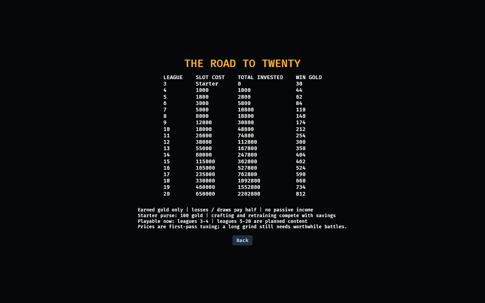

# Gold and league milestones

League 3 starts with three fighters and 100 gold. Gold is earned by finishing local Founders battles. A completed result pays once; aborts and resets pay nothing. No passive income or real-money currency.

The first extra member costs 250 gold. Purchasing it adds a fresh Warrior without changing the founders and expands the local opponent equally: a playable 4v4 league. This purchase is permanent in the local save. **Only leagues 3 and 4 are playable in this build.** Later prices are implemented data and displayed in the menu, not a claim that 20-member battles work yet. Limbs and gear come out of the same purse, so league 4 stays cheap enough to reach while still equipping the first three.

| Destination league | Slot price | Cumulative slot spending | Win reward in that league |
|---|---:|---:|---:|
| 3 | Starter | 0 | 30 |
| 4 | 250 | 250 | 44 |
| 5 | 1,800 | 2,050 | 62 |
| 6 | 3,000 | 5,050 | 84 |
| 7 | 5,000 | 10,050 | 110 |
| 8 | 8,000 | 18,050 | 140 |
| 9 | 12,000 | 30,050 | 174 |
| 10 | 18,000 | 48,050 | 212 |
| 11 | 26,000 | 74,050 | 254 |
| 12 | 38,000 | 112,050 | 300 |
| 13 | 55,000 | 167,050 | 350 |
| 14 | 80,000 | 247,050 | 404 |
| 15 | 115,000 | 362,050 | 462 |
| 16 | 165,000 | 527,050 | 524 |
| 17 | 235,000 | 762,050 | 590 |
| 18 | 330,000 | 1,092,050 | 660 |
| 19 | 460,000 | 1,552,050 | 734 |
| 20 | 650,000 | 2,202,050 | 812 |

A loss or draw pays half the league victory reward. The reward uses the league fought, so an old three-member match cannot claim a higher-league purse. Slot cost purchases capacity and league entry together; local opponents use the same team size. Future reserve slots are a separate design.

From the initial 100-gold purse, league 4 needs 5 victories without spending. Slot 20 costs 650,000 gold: 886 wins at league 19’s 734-gold victory reward, before other spending. The full ladder totals 2,202,050 gold. These deliberately steep first-pass targets need playtesting; no claim is made about retention or balanced pacing.

Other current expenses: class retraining costs 10 gold; one tier-I prosthetic costs 15 gold plus 5 salvage. Victory grants 10 salvage, other completed outcomes 6. The General remains a Paladin. Identity, XP, injuries and appearance survive retraining.

League 5–20 combat, recruitment choices, reserve management, equipment shops, rankings, matchmaking and server discovery remain unfinished.

