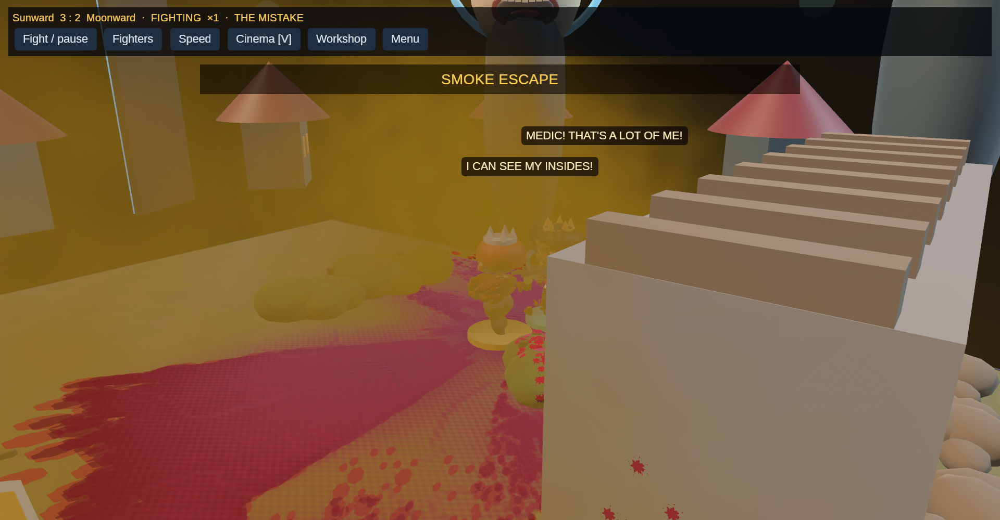

# Patient tactics and flesh wounds

This first playable slice follows the author's choice of severe flesh wounds:
bleeding, effort loss and lasting scars. Theus remains responsible for real
hits, health, effort and healing. Presentation follows those consequences.

## Scouting before commitment

Utility-controlled campaign fighters appoint a scout using their own nearby
allies, discipline, mobility, temperament and injury state. The scout surveys
lanes; companions stage behind. A visible contact or an actual shared contact
starts assembly. The scout seeks distance rather than continuing straight into
melee. The ordinary combat policy resumes after preparation.

Contact starts a 5.5-second assembly period, with an 8.5-second minimum from the
bout's start. Without contact, patience sets a 24–32-second search deadline.
Close threats, injury, bleeding or a critically hurt ally interrupt preparation.
There is no protection against an enemy who arrives early. Scout goals use map
geography and known contacts, never unseen opponent positions or health.

This is an opening policy, not a complete strategic commander. Existing combat
and anti-stall scoring remain after commitment. Lab and learned-controller
baselines remain separate. Pairwise relationships, extended reconnaissance
missions, persistent geography and online model training are future work.

## A wound has a source and a consequence

A successful cutting melee hit of at least 4% maximum health can create a flesh
wound on surviving natural tissue. A separate deterministic draw accepts 12%
of eligible hits; it consumes no tactical random draws. A hit that severs a limb
does not also create this wound. Blunt and ranged contacts do not create this
new injury family.

| Severity | Qualifying hit | Blood budget | Bleeding rate |
| --- | --- | --- | --- |
| 1 | At least 4% maximum health | 6 health | 0.45 health/second |
| 2 | At least 7.5% maximum health | 12 health | 0.90 health/second |
| 3 | At least 12% maximum health | 18 health | 1.35 health/second |

Bleeding spends actual health and 0.8 effort per health lost. Positive healing
also stanches the remaining blood budget one-for-one. Recovering severity
contributes to soreness, capped at six: movement loses 3.5% per point, effort
recovery loses 4.5%, and vaults cost another 0.75 effort. A severity-three
recovering natural leg wound prevents vaulting. Prosthetic substitutes retain
their existing rules. Preferences can also make a physically eligible cautious
fighter decline a vault.

Settlement closes bleeding and records the source battle and hit sequence.
Two subsequent completed bouts clear soreness, leaving scars. Explicit years
of rest in the opening also clear recovery, preserving scars and provenance.
This does not regrow missing limbs. Up to 32 wound records are retained with a
lifetime count. Ordered study exports retain source-linked bleeding receipts
separately from direct damage. Runtime bleeding receipts are capped at 256.

These are authored game rules, not a medical model. Eye injuries and internal
organ simulation are not implemented in this slice. Existing organ debris is
an effect, not proof of a simulated organ injury.

## Readable bodies and skills

The field presents region-based ragged lesions and healed scars anchored to
skin joints, alongside wound flinches, arm guarding, asymmetric limps, torso
hunching and effort/healing reactions. At most five regional marks are visible
per model; multiple injuries in one region share its presentation. The marks
clear the clothing shell for visibility; clothing is not physically torn.
This is surface geometry, not volumetric dissection. The [Kabuki Yard art guide](art-direction/kabuki-yard.md)
describes the 82-clip repertoire, fifteen personality/body-dependent wall
performances, stage paint, mouths and scenery.

Smoke takes its owner's team RGB colour. Each cloud slot has its own material
so overlapping opposing clouds cannot recolour each other. The same smoke
still obscures both sides.



Default skill kits contain the current discipline and mastered disciplines.
Universal catalogue arts can still be equipped explicitly; saved custom kits
remain intact. This corrects the previous defaults that silently gave every
class all three universal ninja arts.

The skill screen distinguishes current-class access, incomplete practice,
permanent retention and active slots. Every completed Healer bout grants 25
class practice regardless of result; 100 retains Mend wounds after retraining.
Actual Medicine practice is separate. Retraining preserves partial class
practice. No practice was granted or save edited for this change.

## Local evidence and limits

The example `patient_combat_study` runs eight consecutive real generated-map
bouts with authored Warrior/Scout/Healer profiles, saving and reloading between
bouts. Seeds 42–49 in `outputs/patient-combat-study-03` produced first hits at
9.2, 14.2, 14.7, 12.7, 14.7, 14.2, 13.4 and 19.7 seconds: median 14.2 seconds.
The bouts produced 123 new flesh wounds and 131.36 health lost to bleeding.
These are fixture observations, not an injury-frequency target, comparison
against a controlled baseline, human playtest or proof of balanced pacing.

```sh
cargo run --offline --locked --no-default-features --example patient_combat_study -- outputs/NEW_STUDY_DIRECTORY
cargo test --offline --locked --no-default-features
cargo test --offline --locked --bin phalanx
cargo fmt --all --check
cargo clippy --offline --locked --no-default-features --all-targets -- -D warnings
python3 tools/validate_character_assets.py
python3 tools/validate_face_assets.py
python3 tools/validate_motion.py
.venv/bin/python -m unittest analysis.test_cognition
```

Local checks passed: 198 simulation tests, 71 graphics tests, three cognition
loader tests, strict headless Clippy and the asset validators. The motion
checks cover all fifteen wall performances and all sixteen new living clips.
The chapter UI-flow fixture uses a legal Protector style and repairs missing
limbs using earned resources; it does not establish unassisted opening balance.
Optional strict graphics Clippy still reports existing graphics lint debt.
No hosted CI or human playtest was run.

Rendered reviews use disposable directories and disable autosave. The flesh
review simulates real seeded combat until a wound occurs, then pauses and hides
other models for inspection; its JSON names the actual source hit. Always close
the previous PHALANX process and verify none remains before a new visual review.
The player's existing campaign is not a review fixture.
