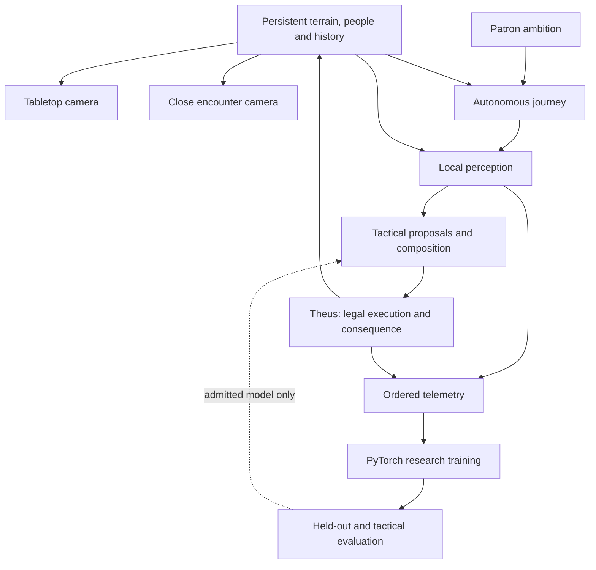

# A persistent Yard, autonomous ambitions, and learned opposition

Author direction, 2026-11-03: the patron sets broad ambitions and watches the
Phalanx choose its journeys. A tabletop world view and close combat represent the
same place. The encounter should not appear to have been cut into a small arena.
Deep telemetry and substantial PyTorch work are central to the game and portfolio.
Visuals, techniques, sound and music must develop with that simulation.

This is the architecture for that expansion. The current game still uses arenas,
the three opening chapters and the existing campaign. The telemetry and research
model described under “Implemented foundation” are implemented in this change;
the world, autonomous travel and adaptive opponent deployment are future work.

## One world, two scales of attention

Target architecture; shared geography, journeys and live model admission are
future components:

The Yard becomes a persistent region containing roads, training grounds, ruins,
settlements and the houses. The Register remains asynchronous published-company
encounters with their existing provenance limits. The young King, subsequent
queen and general retain their identities and story gates. Standard campaign
progression remains 3v3 then 4v4; five tutorial teams remain sequential opponents.

The tabletop view is a camera and information view over the world. Combat
activates more detailed simulation around an encounter's actual location. The
camera descends there. The road they travelled, surrounding hills, obstructions
and escape routes remain connected to that location.

Terrain, height, cover, support, anchors and destructible structures must come
from the same authoritative world queries in both views. Reusing a location name
or terrain seed while replacing the ground with a generic arena is insufficient.
Landscape beyond the encounter remains visible. Combat activation must expand
with fleeing fighters or arriving participants rather than end at an invisible
rectangle. Streaming limits and campaign boundaries need explicit rules and
telemetry; scenery must not imply a traversable route that the rules forbid.

Use persistent world/chunk addresses with local coordinates for rendering and
physics. An encounter carries its world address, terrain revision and activation
domain. A floating render origin must never change historical coordinates.
Legacy arena histories retain an unknown world address rather than acquire an
invented geographical past. No world coordinates are fabricated in today's feed.

Before calling this persistent geography, demonstrate:

1. A road and terrain height agree when sampled from adjacent chunks and both views.
2. Travel reaches the same location where combat starts; actors keep their IDs.
3. A broken barricade changes navigation and remains broken after departure/reload.
4. Retreat crosses the original encounter extent without a map edge stopping it.
5. Save/load preserves terrain revisions, world time, actors and encounter receipts.

## The patron sets ambitions

Examples include improve the company, seek a difficult opponent, explore the
ruins, protect a settlement, recover, and establish a foothold. These are goals,
not a destination queue controlled by the player.

Strategic choice uses known locations, travel time, equipment needs, actual
injuries, available training, remembered threats and eventually personal bonds.
It should explain its alternatives: “We chose the northern school because two
fighters need mobility training; the quarry route is dangerous with a missing leg.”
The explanation must be generated from the decision record and actual known state.

Strategic journeys produce tactical encounters. Tactical planners compose legal
primitives. Theus resolves capabilities, costs and consequences. A world goal,
neural proposal or cinematic opportunity cannot grant an unearned skill, a usable
limb, knowledge through a wall, a successful rescue or an invented victory.

## Progression broadens what a fighter can attempt

Develop techniques in families: footwork, strikes and guards, grappling, ranged
handling, traversal, interception, cooperation and recovery. Future specialisms
can include fighting from a damaged stance, using an off hand, reading a feint,
maintaining a shield line, recovering from a throw and controlling a landing.

Each technique needs a capability definition, observed preconditions, a legal
primitive or sequence, effort/timing costs, failure/interrupt consequences,
practice receipts and presentation mappings. A catalogue entry is not a working
ability. Start with a few interacting techniques that change combat, then broaden
the vocabulary. Training should open alternatives and improve execution while
remaining constrained by Theus. School attendance alone must not invent practice.

Examples for future implementation, rather than a list of shipped moves:

| Family | Possible sequence | Required world/rule effect |
| --- | --- | --- |
| Reading and footwork | Measure → feint → outside step → thrust | An observed defence, legal foot placement, real attack timing and opposed resolution |
| Shield control | Catch → turn → shoulder check | A usable shield/limb, actual interception and resolved displacement |
| Grappling | Grip → off-balance → throw | Reach, a successful opposed grip, support geometry and separate fall/collision consequences |
| Traversal | Wall step → ledge catch → climb | Surface contact, reachable grip, usable limbs, effort and a checked route |
| Recovery | Break fall → roll → rise | A real fall, limb-dependent mitigation and an interruptible recovery state |
| Cooperation | Create opening → intercept pursuer → ally withdrawal | Identified allies/attackers, communication limits and an intervention that physically succeeds |

The breadth should come from combining these primitives with weapons, injuries,
surfaces and partners. The telemetry must distinguish an attempted chain from its
completed steps and interrupted ending.

The rule on outcomes remains: equal completion XP/class credit, gold and salvage
for both sides; no victory, survival or damage multiplier and no automatic
temperament drift. Actual practice and witnessed event memories remain. Learning
an opponent policy is a separate process from changing a fighter's personality.

Animation variants should reflect handedness, weapon, momentum, footing, injury,
effort, skill and the resolved technique. A grounded strike cannot display an
unexecuted vault. Expand legal mechanics and motion assets together. Evaluate
readability, foot contact, interrupted motion, impact timing and visible diversity
in real captures, rather than reporting only the number of exported clips.

Sound should follow resolved contacts, equipment/material and listener position.
Layer close impacts, motion, breath, environmental acoustics and distant activity.
Music can combine existing stems using encounter pressure, separation and recovery;
those presentation values confer no combat power. Check loudness, clipping,
repetition and transition behavior in actual playback before claiming improvement.

## PyTorch becomes an evaluated learning component

Separate three questions:

| Model | Data it may use | Purpose |
| --- | --- | --- |
| Self/decision model | That actor's preceding observations and actions | Study habits, prediction errors, hesitation and tactic transitions |
| Opponent-visible model | What this observer actually saw or legitimately learned | Predict an opponent without reading hidden intent or state |
| Tactical policy or value model | Legal local observations, history and objectives | Choose or rank legal actions; Theus still executes consequences |

Study the player over successive encounters and study the opponents' own failures.
Training objectives may assess tactical quality, but cannot change completion
awards, innate temperament or the rules to manufacture difficulty. Difficulty
must come from decisions, preparation and cooperation under the same constraints.

Train candidate models away from the gameplay thread in isolated, bounded CPU/GPU
workers. Start with offline recorded experience and reproducible self-play.
Between-encounter updates can follow once data eligibility, evaluation and model
publication are reliable. Preserve a known policy and a legal Utility fallback.
Do not update weights midway through an opposed check or silently replace a model.

Candidate admission needs model/dataset hashes, complete provenance, held-out
encounters, observation-leakage counterfactuals, legality checks, inference timing,
and actual combat evaluation against current and historical opponents. Compare
multiple seeds, maps, styles and injuries. Report failures and regressions as well
as wins. A prediction score is not evidence of stronger combat, fair difficulty
or a rewarding human challenge. Shadow predictions must be labelled proposals.

## Telemetry is the common foundation

Retain distinct records for observations, model proposals, admitted decisions,
planned primitives, interruptions, resolved physical consequences, practice and
history. Include model and source identities, event sequence, fixed simulation
time, actor identity and the relevant coordinate frame. World activation, model
replacement, selected animation clips, sound samples and music transitions will
need their own receipts. Today's simulation feed does not record rendered poses
or audio playback timing.

Full-state research truth is useful for diagnosis and outcome analysis. It must
remain distinguished from the observations supplied to an agent. An opponent
model cannot consume another fighter's private decision features simply because
those features exist in the research archive.

The storage progression is versioned JSONL shards per battle, verified manifests,
then typed Parquet tables for larger longitudinal studies. Proposed table families
are sessions, decisions, observations, technique resolutions, motion frames,
world changes, practice and model evaluations, joined using stable identities and
source/run/time keys. Preserve nulls for unavailable world or relationship context.

PySpark belongs in that offline aggregation and experiment pipeline. It can later
partition many campaigns, construct training views and compare long-term drift.
The first new corpus is roughly 57 MB across 36 self-play battles; the implemented
reader is bounded and local. No Spark dependency or cluster is installed by this
change. Before adopting Spark, establish representative volume, local memory
limits, explicit schemas and agreement with a small reference aggregation. Spark
must not become a process in the combat loop or an excuse to load every trace
into workstation memory.

## Implemented foundation

The [study recorder](../src/study.rs) now emits an ordered telemetry-v2 feed with
source build identity, optional campaign battle ID, normal decision observations,
post-step motion/effort/practice snapshots and actual opposed Theus receipts.
It flushes frames during recording and retains incomplete-study status. Recording
is tested against an unrecorded simulation for exact combat equality.

The [PyTorch sequence study](../analysis/cognition.py) forecasts the next decision
from strictly earlier actor observations/actions. It excludes world-truth frames,
future masks, utility scores, results and rewards from inputs. It separates whole
seeds and fighter identities, fits normalization on training data only, selects
on validation loss and compares with persistence and a trained Markov baseline.

Its input is the decision maker's own prior observation. It is therefore a
research self/player model, not a deployed opponent-visible predictor or an
online learning opponent. The [v12 evidence](results/v12/README.md) records the
measured result and the admission boundary.

The next world implementation should establish shared terrain coordinates and
persistent changes first. Autonomous travel can then use real place/state
continuity. The opponent-visible dataset and tactical evaluation are the next
learning requirements before adaptive PyTorch control is admitted to play.
