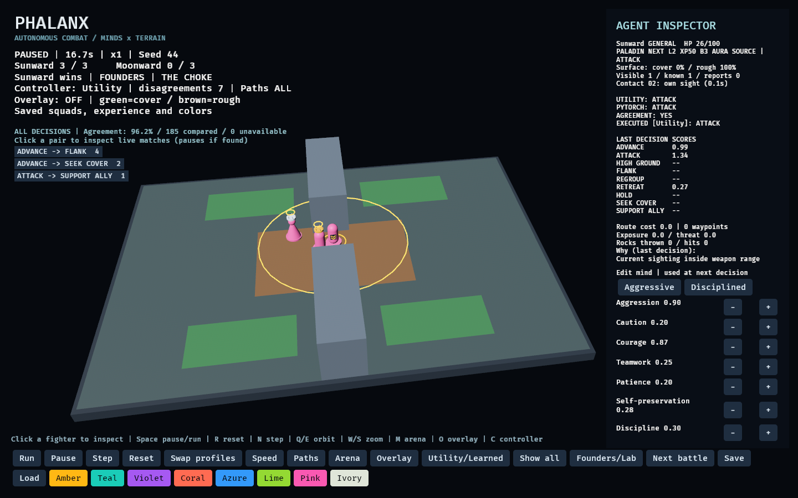

# Persistent squads and the Paladin

Founders now runs a local progression loop on the same simulation as PHALANX Lab. Each squad keeps its fighters across battles; their titles can be reassigned independently of class. The two local squads are named **Sunward** and **Moonward** by default; their heraldry is a saved preference rather than their identity.



## Play the loop

1. Select a fighter, adjust its mind, and choose a team color using the palette buttons. Colors apply to the selected fighter's whole squad.
2. Run a battle. The Paladin's gold ring shows its aura radius; blessed allies have a small halo.
3. A completed battle records XP, wins, survival, damage, and history exactly once, then autosaves.
4. Click **Next battle** to advance the seed and restore the same fighters at full health with their earned progress.

**Save** writes your local squads. **Load** reloads the saved squads and starts a fresh battle; it does not resume mid-combat. Startup automatically loads an existing valid save and continues from the last completed seed unless `--seed` is supplied. **Reset** restarts the battle without rewarding an unfinished attempt. Arena changes retain squad identity and progression. **Swap profiles** exchanges the squads' mind configurations while preserving identities and colors.

The current save is `outputs/phalanx-save.json`. Writes use a temporary file and preserve the previous file as `phalanx-save.json.bak`. Invalid saves are left untouched at startup; automatic writes are disabled until an explicit Save. Both files are local and ignored by Git. Version-1 save validation checks schema, fighter IDs, titles/classes, colors, trait bounds, progression, and history. This is local persistence, not an online anti-cheat system.

## Starting General and Paladin discipline

The starting General trains as a **Paladin**. Any fighter may train this discipline, and a General may train any other discipline. The Paladin discipline provides melee combat and a support aura. At the beginning of each simulation tick, living allies within **4 horizontal units** and a clear segment through the arena receive:

| Effect | Rule |
| --- | --- |
| Blessing | +5% outgoing damage; 10% less incoming damage |
| Motivation | +0.10 effective courage and discipline, capped at 1.0 |

The aura excludes its caster, does not affect enemies, does not stack, and stops on the next tick after the source dies or an ally leaves range. Walls block it. The temporary motivation boost does not overwrite persistent mind traits. Royalty, class, and experience are independent properties.

## First progression rules

A completed battle grants each fighter **25 participation XP**, plus **15 for victory**, **5 for survival**, and up to **10 for damage contribution**. Both local squads progress. Every 100 XP adds a level, capped at **level 10**. Each level above the first adds **2 maximum HP and 1% base damage**. The King/Queen's existing royal bonus remains separate. Surviving and eliminated fighters both return for the next battle; limb wounds now persist, and crafted Iron I prosthetics can replace missing parts. HP zero means battle incapacitation in this prototype; permanent character death is not implemented.

Battle-conditioned habits are deterministic and small:

- Finishing below half health: +0.01 self-preservation.
- Using support: +0.005 teamwork.
- Winning: +0.005 courage.
- Surviving after retreating: +0.005 discipline.

Traits remain within 0–1. These are authored adaptation rules, **not online PyTorch training**, and they do not establish that veterans make better decisions. The frozen imitation policy remains available for same-state comparison. Improvements in tactical quality need their own experiment.

## Psychological scars

A completed Founders battle can mark a fighter. There is no sanity meter. Each scar names one trigger and one reaction. The seven mind traits stay the fighter's personality; the scar is what that personality learned.

| Trigger | What counts | What a personality may learn |
| --- | --- | --- |
| Isolation | More than 40 ticks with no living ally within 5 units | Fear, attachment, hesitation, or recklessness |
| Encirclement | More than 15 ticks with enemies on opposite sides, or three within 4.5 | Fear, hesitation, or recklessness |
| Ally loss | A teammate falls within 8 units | Attachment, fear, hesitation, or recklessness |
| Failed charge | An advance loses at least 8 HP before the next choice | Hesitation, or recklessness if aggressive and undisciplined |
| Confidence | Survive below half health, or survive after 80 isolated ticks or 30 encircled ticks | A separate steadiness score. Courage gains more; self-preservation gains less |

The same exposure writes the same intensity on different minds, and a different reaction. One battle adds at most **0.55** intensity. A contradicting personality wears the old reaction down to zero before a new one is written. Dying trims confidence by 0.05 and leaves the scars.

During the next battle the scar changes utility scores only while its trigger is happening again. Fear of isolation can open a retreat and pull the fighter back to the squad. Recklessness from the same isolation raises the charge. Blank minds, and every Lab battle, keep the old scores. The inspector shows the saved scars. A matching bark can say them out loud.

## Roadmap position

Persistent fighter data now lives separately in `src/progression.rs`; `Unit` remains the temporary combat state. Validated saved squads can create a deterministic battle and produce a serialized result, with a save/reload replay test. This closes Phase A's snapshot foundation.

Phase B now has stable IDs, names, command titles, classes, minds, XP, records, and recent history. Both supplied body bases now have game-ready skinned copies and basic combat clips; persistent limb wounds and a first prosthetic recipe are implemented. Phase G now has the first psychological scars: isolation, encirclement, ally loss, failed charges, and confidence. Relationships are still unfinished. Phase C has persistent squads, save/load and a first fourth-member recruitment purchase; a dedicated roster and reserve screen remains unfinished. The eight launch classes plus Rock Thrower and Paladin now have mechanics and retraining controls. The first 250-gold recruitment unlock expands both local sides to four fighters. Founders battles now generate a mirrored pressure field for leagues 3 and 4. A three-fighter field is 36×26 and a four-fighter field is 48×34. A full roster/bench screen and leagues 5–20 remain unfinished.

Lab rosters, seed-42 Choke results, and frozen experiment artifacts remain unchanged. Lab battles do not grant campaign XP. Progression tests cover real aura damage/range/death, persistent growth, duplicate rewards, snapshot replay, invalid data, backups, colors, and bounded progression.

## Wounds, salvage and first crafting recipe

Founders who remain above zero HP can lose an arm when damage crosses 50% maximum health, and a leg at 25%. The side is deterministic from seed and unit ID. Losing an arm reduces damage by 20%; losing a leg reduces movement by 35%, multiplicatively per unreplaced limb. They continue fighting. Reaching zero still incapacitates them for this battle.

Completed battles keep the missing limbs and replacements with the same fighter ID. First recorded loss of each limb has a permanent battle-ID record; the latest twenty battle summaries also store limb state. HP recovers next match; limbs do not grow back. Aborting/resetting an unfinished match does not settle its wounds or rewards.

The squad earns **10 salvage for victory, 6 otherwise**, once per completed battle. Before a match starts or after it finishes, select a fighter and click **Craft iron I (15 gold + 5 salvage)**. It crafts one missing replacement, arms before legs. Insufficient funds and repeated attempts without a missing limb leave the inventory unchanged. Prosthetics currently use this simple recipe; equipment levels and alloy reforging are separate.

A tier-I iron arm restores the missing-arm penalty, multiplies the fighter's damage by **3**, and imposes **15% slower movement** for balance/weight. Two arms do not stack that multiplier to 9×. An iron leg restores that leg's movement penalty. These are early balance constants, not measured balanced equipment. A severe crossing can destroy an equipped replacement. No durability meter, higher crafting tiers, retirement or reserve roster exists yet.

Appearance controls change Body, Hair, Face, Eyes and Nose for any selected Founder; title does not lock body choice. Preferences persist with the fighter and have no tactical effect. The current inspector scrolls with the mouse wheel so the expanded controls do not cover the bottom toolbar.

[Character, painting, gore and rendering details](visual-combat.md). [Proposed roster and replacement loop](roster-design.md).

Gold rewards, recruitment milestone and the full priced 3–20 ladder: [economy](economy.md).

## Equipment workshop

Select a Founders fighter and scroll the inspector to the recipe buttons. Craft before the first tick or after a completed battle. Gold and salvage come from the existing battle rewards. Crafting equips the item immediately; after battle, it takes effect in the next battle. Each fighter owns their own gear. Click an owned recipe to equip or remove it for free. Replacing an item retains the previous item in that fighter's inventory.

| Recipe | Gold / salvage | Effect |
| --- | --- | --- |
| Tempered weapon | 25 / 8 | +20% damage, -8% movement |
| Balanced weapon | 20 / 6 | +8% damage, +5% movement |
| Throwing spear | 30 / 8 | 100 rock practice; 6 spears, planted windup, first-body interception |
| Atlatl | 45 / 12 | 100 spear practice; 4 darts, longer range and windup |
| Bow | 55 / 14 | 100 atlatl practice or Ranger mastery; 12 arrows, draw/aim/release |
| Iron armor | 30 / 10 | -20% incoming damage, -15% movement |
| Trail armor | 20 / 6 | +12% movement, +8% incoming damage |
| Vitality charm | 35 / 12 | +60 maximum HP |

One weapon, one armor, and one charm may be equipped together. Multipliers combine with class, level, wounds, and blessings. Recipes work across classes. Starter/quality weapons retain their class silhouette; crafted spears, atlatls and bows replace the hand-held weapon and select the attack behavior. Crafted weapons add silver or gold fittings; iron armor adds a steel breastplate and metallic garment treatment; trail armor adds leather straps and a leather garment treatment; the vitality charm adds a green chest gem. The inspector reports the loadout and effective damage, movement, and incoming damage multipliers. Loadouts persist with the squad; older saves receive empty inventories. Lab battles retain their original stats. Recruitment starts with an empty inventory.


## Health and healer feedback

Living fighters have overhead HP bars with current/maximum HP. Bars turn amber below 60% and red below 30%; dead, offscreen, menu, and panel-covered bars are hidden. Nearby labels stack to avoid overlap.

Retraining the Queen as a Healer preserves her title and royal HP. An unmastered Healer restores up to 12 HP to a wounded living ally within five units and clear line of sight, with a 1.2-second cooldown. Successful restoration produces a brief green caster-to-target link, rising green crosses, and a `+HP` popup. Effects reflect actual restored HP after simultaneous damage and the maximum-HP cap, including when the target takes damage on the same tick. Fatal damage cannot be healed into a resurrection. Multiple healers share the actual restoration credit. The simulation retains the latest 64 restoration events for presentation.

For a reproducible graphics check, run `phalanx --visual-witness --healing-witness --arena open --seed 42` from a disposable directory with an `assets` link to the game assets. This stages a wounded King and a Queen retrained through the inspector controls, crafts gear, and captures `outputs/healing-witness.png`. It is a staged QA battle, not a normal player's progression result.

## Battle report and squad workshop

Completed Founders battles open the battle report after rewards settle. It records the arena, seed, outcome, actual gold/salvage awarded to each team, and each fighter's survival, remaining HP, damage, healing, XP, and new missing limbs. Healing totals cover the whole battle, independently of the bounded presentation-event queue. The latest report is serialized with the campaign and remains available from **Battle report** or **Last battle report** after restarting.

Open **Squad workshop** from the arena controls or main menu. Select any member for a large rotatable character preview, missing limbs, prosthetics and drag-and-drop equipment. Use the Skills, Forge, and Training & titles tabs for preparation. The shared chest transfers physical items between fighters. The forge upgrades items to level 5 and melts them into stronger alloys. See the [RPG workshop](rpg-workshop.md) for capacities, progression, and save compatibility. Lower incoming-damage multipliers mean greater protection.

The campaign's serialized fighter records own inventories and equipped slots. Previews derive temporary copies using saved class, XP, wounds and equipment; they exclude temporary blessings and low-health rage bonuses. Confirmed preparation changes use the existing campaign operations and autosave path. Before the first tick they also update the staged battle unit. After a completed battle they affect only the next battle's freshly generated roster; the completed combat snapshot and saved report remain unchanged. Preparation actions are blocked while a battle is in progress.

**Next battle** closes the camp screen and stages the same persistent squad at full HP, preserving missing limbs, prosthetics, gear, minds and psychological scars. It starts paused. Reopening a report never settles rewards again. This uses the existing recovery rule; no timed recovery, hospital, or reserve-roster system is introduced.

Graphics checks use a disposable working directory with an `assets` link:

```bash
/path/to/phalanx --visual-witness --camp-witness --arena open --seed 42
/path/to/phalanx --visual-witness --camp-witness --workshop-witness --arena open --seed 42
/path/to/phalanx --visual-witness --camp-witness --workshop-witness --camp-scroll-witness --arena open --seed 42
```

These stage and complete a real seeded simulation with a Queen healer, then craft a balanced weapon using battle salvage. Captures are staged QA evidence, not player battle history. The scrolling check sends a mouse-wheel message through the normal screen handler.


## Independent titles and retained abilities

Titles, active discipline, permanent mastery, equipment and identity are separate serialized fighter properties. Workshop title buttons assign an office for free. Assigning an occupied title swaps the two holders' titles; assigning Member vacates the selected fighter's office. Each squad can have one of each named office and any number of Members. Offices are optional, and title assignment does not change class, fighter ID, body choice, name, gear or practice. Existing title-based body defaults are frozen before reassignment so a new title cannot change an existing fighter's appearance.

Title bonuses: King/Queen +30 maximum HP and +10% damage; General -10% incoming damage; Captain +10% movement; Champion +10% damage; Member no bonus. These follow the current holder. The General's title protection is distinct from Paladin's blessing. Preparation changes update the staged roster before battle; post-battle changes apply next battle and preserve the completed report's original titles.

Completed-battle XP also trains that fighter's active discipline, once per settlement. Practice is independent for all ten disciplines; 100 retains the supported skill after retraining, with ranks at 100/300/600. Retraining retains accumulated practice, so partial training can be resumed later. Older saves start at zero practice; historical class use cannot be reliably reconstructed. A new recruit starts at zero practice rather than inheriting the template fighter's skills.

See [the mastery effects and limits](classes.md#titles-and-permanent-mastery). The latest battle report records the titles held during combat; legacy reports without that field show “title not recorded.”


## Mandatory squad standards and heraldry

Every squad has a persistent flag design and one designated standard-bearer. New squads start with a Sun or Crescent emblem; older saves receive a valid default design. The third fighter is the default bearer, independently of that fighter's current class or title. Every squad must retain a designated bearer; choosing another fighter transfers that duty rather than removing the flag.

In **Squad workshop**, select a fighter from the desired squad. **Next emblem** cycles Sun, Crescent, Diamond, Cross and Chevrons. **Primary color** cycles the shared squad palette; **Accent color** changes the flag border and insignia. **Make selected standard-bearer** assigns the duty to that fighter. These settings serialize with the squad. Before battle, reassignment updates the staged carrier; post-battle reassignment applies next battle. Changes are blocked during active combat.

The physical standard uses a long thin wooden pole, metal brackets and a leather armor socket on the back. A top crossbar carries a tall, double-sided cloth panel with the squad's colors and emblem. The panel ripples with authored wind deformation and stronger movement flutter, while the pole remains attached to the animated torso. Both hands stay free. The flag stays attached to the fallen body; it does not project an aura from a downed bearer. Cloth and pole do not have independent collision simulation.

The designated bearer, active Banner Bearers, and fighters with an equipped War Banner display the same squad standard. Extra standards do not stack rally bonuses. A retained Banner Bearer skill can use either the designated standard or an equipped war banner; carrying a flag never grants an unlearned rally skill. Flag assets are derived from saved heraldry, not serialized meshes or textures.

Close-up graphics checks: `--visual-witness --standard-witness --arena open --seed 42`, adding `--standard-back-witness` for the rear armor mount. Run checks from a disposable working directory with an `assets` link so QA cannot modify the player's save.

## Physical contacts, generated arenas and rivals

Living fighters on both teams occupy 0.45-radius discs. A deterministic spatial hash selects swept collision candidates; continuous contact resolution stops tunneling, preserves stationary defenders and slides moving crowds around one another. The renderer follows the resolved movement trace. Bodies on the ground do not block standing fighters. Contact records contain the surface point, relative velocity and closing speed. Opposing charging contacts above 3.2 speed can deal capped impact damage; Guardians return recoil damage. Normal crowd contacts do not produce blood.

Damage events drive directional airborne droplets, with heavier blunt drops and wider severance sprays. Droplets stamp a persistent terrain-following stain canvas. Moving fighters with unprosthetized limb wounds leave small drips. The canvas resets for a new battle; its memory and droplet pool are bounded. This uses the existing limb-wound state, rather than a separate bleeding simulation.

Generated campaign fields store their seed and layout in the battle snapshot. Eight mirrored layouts combine four destructible barricades, a central elevation, rough approaches, cover and two flanks. Navigation checks connect deployment zones to the objective and both flanks. Fighters can break nearby obstructing barricades; destruction opens navigation immediately. Reports retain the initial arena for replay. Identical seed, squads and build reproduce the simulation; these are constrained authored layouts with seeded variations, rather than an unconstrained world generator.

The **Rival phalanxes** tab selects Obsidian Coven, Iron Sentinel, Bloodhound Syndicate, Vanguard of the Sun or Null Collective. Moonward remains available when swapped into the reserve list. All rosters, offices, standards, equipment, practice, wounds and resources persist. Only the rival actually fought earns progress. Rivals spend earned currencies on gear, prosthetics and cross-training, and can unlock spears/atlatls/bows through their own earned weapon practice; Null uses observed player composition and the last match's healing to choose counters. This is deterministic adaptation, not a trained online model. Guns, life leech and new stun abilities remain future class content.

Weapon practice and technology details: [Rock → spear → atlatl](weapons.md).

## Local snapshot exchange

Phase L now has an isolated exhibition workflow: export a published team, import an opponent, fight a frozen challenge and export its complete reproducible result. Both playable leagues are supported. A recipient replays the packet to check the recorded battle. Original campaigns, rivals, rewards and injuries remain unchanged; importing a result never settles progression. [Controls, headless exchange and current verification limits](snapshot-challenges.md).
