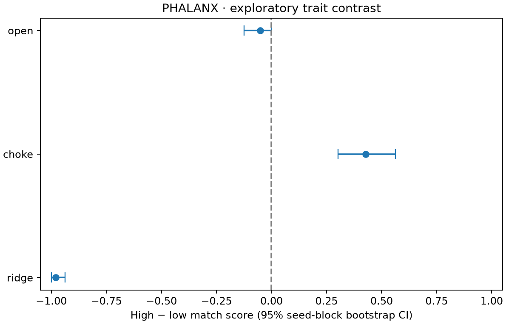
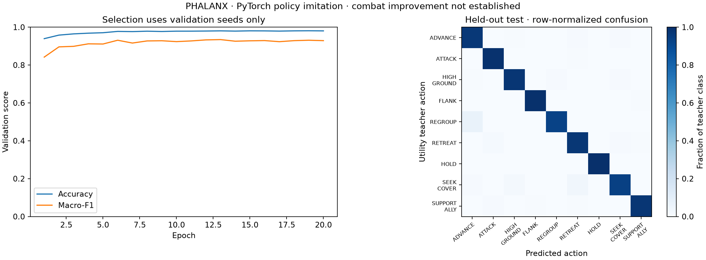

# PHALANX v0.4 — first measured baseline

This is an exploratory simulation study and a trained PyTorch imitation model. The live game continues to use utility AI. The network is an offline baseline; it has not been deployed as a combat controller.

## Data and protocol

864 complete battles: three studies × 48 seeds × three arenas × two spawn orientations. Source commit: `be8efd20c5068124060f7adc46e58e5af807b0a2`; collection ran with a clean tracked tree. Each study manifest binds source/binary/configuration and generated files by SHA-256. Full raw output is 472 MB locally and can be regenerated with the commands in [the analysis guide](../../../analysis/README.md). Curated manifests, battle CSVs, one held-out trace, metrics, figures, and model weights are published here.

Teamwork and caution contrasts use low=0.2/high=0.9 with every other trait=0.5. Both teams have three melee fighters and two throwers with identical role-specific combat statistics. The profiles collection uses the original aggressive/disciplined presets; generic low/high numeric flags in its manifest are unused. It is training data, not a single-trait contrast.

## Trait contrasts

High-minus-low match score assigns a win 1, draw 0.5, loss 0. Each seed block averages both orientations; 95% percentile intervals resample 48 complete seed blocks 4,000 times. Maps are separate; intervals are exploratory and not adjusted for multiple comparisons.

| Trait | Arena | High wins / battles | Draws | Score advantage | 95% block CI |
| --- | --- | ---: | ---: | ---: | --- |
| teamwork | ridge | 12 / 96 | 0 | -0.750 | [-0.875, -0.625] |
| teamwork | choke | 14 / 96 | 1 | -0.698 | [-0.823, -0.562] |
| teamwork | open | 1 / 96 | 1 | -0.969 | [-1.000, -0.917] |
| caution | ridge | 1 / 96 | 0 | -0.979 | [-1.000, -0.938] |
| caution | choke | 68 / 96 | 1 | +0.427 | [+0.302, +0.562] |
| caution | open | 45 / 96 | 1 | -0.052 | [-0.125, +0.000] |

High caution has opposite observed outcomes on Ridge and Choke. High teamwork underperforms on all three maps in this configuration. These results describe this authored utility policy and fixed arena family; they do not establish a general law about teamwork or caution. They motivate examining decision traces and controlled action/weight ablations, rather than claiming that adding coordination automatically improved combat.



## PyTorch policy

The network learns the teacher's eligible tactical choices from 29 perceived-state features. Its two hidden layers have 64 units each; it has nine action outputs and **6,665 parameters**. Score magnitudes, selected actions, future states, and hidden enemy positions are excluded from model inputs. The eligibility mask is supplied by existing guards to every controller comparison.

| Split | Seeds | Decision records |
| --- | --- | ---: |
| train | 0–31 | 268,906 |
| validation | 32–39 | 66,879 |
| test | 40–47 | 67,587 |

Normalization uses training data only. Twenty epochs were run with training seed 2026; validation macro-F1 selected epoch 13. All studies/maps/orientations for a seed remain in one split. Held-out test was evaluated after checkpoint selection.

| Held-out metric | Result |
| --- | ---: |
| Masked action agreement | 97.91% |
| Supported-class macro-F1 | 0.932 |
| Attack/advance/first-eligible baseline agreement | 73.06% |
| Uniform-eligible expected agreement | 37.11% |
| Raw unmasked eligibility | 53.89% |
| Single-observation forward+mask median / p95 | 16.18 / 16.48 µs |

**Eligibility masks are essential.** The network was trained with masked logits; its unconstrained outputs are frequently ineligible. Masked validity is 100% by construction and is not evidence that the network learned world legality. The latency measurement excludes feature extraction, normalization, model loading, and the simulation.



This is imitation of the current utility policy, not generative reasoning, reinforcement learning, or evidence of improved combat. Test seeds share the training arenas and configurations; new arenas and arbitrary personalities have not been evaluated. HOLD has only 19 test examples, so that class's result is especially limited. Decision-level accuracy weights long battles more heavily and should not be interpreted as 67,587 independent experimental trials.

## Saved model and verification

[policy.pt](policy/policy.pt) contains real trained weights and train-only normalization. [metrics.json](policy/metrics.json) contains per-class metrics, baselines, split membership, learning history, dataset-manifest hashes, and timing. A fresh model loaded the checkpoint and evaluated the entire held-out split; the published reload witness was independently verified after copying the artifacts.

```bash
.venv/bin/python -m analysis.predict docs/results/v04/policy
```

[Sample held-out decision trace](sample/choke-0040-normal.jsonl) · [Sample final battle](sample/choke-0040-normal.json)

Dataset manifests and CSVs: [teamwork](teamwork/manifest.json), [caution](caution/manifest.json), [profiles](profiles/manifest.json). Recorded source fingerprints are identical across all three studies. Model SHA-256: `923f16100436e42dee2b2dbdee2c7069e3fd95bb1de51f05222da26d7f88b316`.
