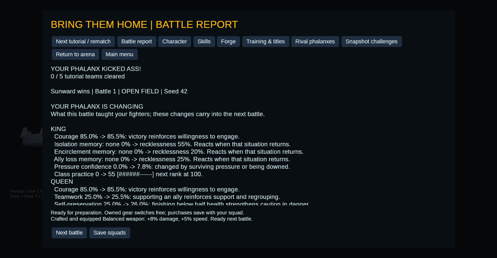

# Campaign adaptation and native Bonsai: inspectable evidence

Captured October 31, 2026 from the clean implementation commit
[`dac8ed8`](https://github.com/Fiendstar77/phalanx/commit/dac8ed8879d0612e1abf95ef50e450ec3c83c9c4).
The [manifest](manifest.json) records source hashes, executable hash, commands,
machine details, native settings and artifact hashes. No model download is
needed to inspect this directory.

## Start here

| Artifact | What it lets you inspect |
| --- | --- |
| [Three-battle evolution report](campaign/report.md) | Actual persistent changes across three completed 3v3 battles |
| [First battle report](campaign/battle-200/report.md) | Outcome, action counts and Utility/PyTorch comparison |
| [First battle learning receipts](campaign/battle-200/learning.json) | Fighter identity and before/after experience, practice, traits and memories |
| [Raw decision trace](campaign/battle-200/decisions.jsonl) | Initial setup, perceived state, eligibility, scores, proposals and executed actions |
| [Decoded Bonsai observations](tactical/observations.json) | Model inputs, raw responses and reference choices kept out of the prompt |
| [Bonsai tactical comparison](tactical/report.md) | Twelve uniformly sampled recorded decisions and hypothetical governed actions |
| [Deadline failure report](deadline/report.md) | Three timeouts retained as utility fallbacks |
| [Combat-text outputs](barks/report.json) | Real native outputs under the 20-word, one-line contract |

## Observed results

The campaign uses seeds 200–202, preserving and saving/reloading its fighters
between battles. It loses twice and wins once. The player's King's class
practice accumulates 0 → 35 → 70 → 125, crossing the first class rank; experience
also crosses a level threshold. The reports expose habit and conditioned-memory
changes. This demonstrates persistence and explicit adaptation, not a causal
explanation of the third battle's win. There are 2,015 decision records across
the three battles.

| Native study | Requests | Accepted | Utility fallbacks | Timing scope |
| --- | ---: | ---: | ---: | --- |
| Tactical shadow, 10-second budget | 12 | 12 | 0 | Mean 2.748 seconds per request, including model loading |
| Deadline probe, 1.5-second budget | 3 | 0 | 3 | All time out; cleanup can extend measured wall time past the requested deadline |
| Combat text, 20-word cap | 3 | 3 format-valid lines | Not a tactical controller | Per-case timing and raw text in the report |

Among the twelve accepted tactical proposals, agreement is 50% with utility
and 41.67% with the frozen PyTorch reference. These are descriptive comparisons
on a small correlated sample, not independent trials or proof that disagreements
are better choices. The eligibility mask is supplied by existing rules; the
model has not learned legality.

Native configuration: Bonsai 1.7B GGUF, greedy sampling, four CPU threads,
zero GPU layers, up to 48 generated tokens per case, AMD Ryzen 9 7950X workstation.
Each request starts a process and reloads the model. No inference server is
used. Model, library and runtime identifiers are in the individual reports.
The 10-second run is an offline probe, not a revision of the tighter result.

## What this establishes

Campaign state changes persist into subsequent battles. The native model
generates real outputs on recorded decision observations. Strict validation
accepts eligible JSON and exposes timeout fallback. The reports retain the
evidence needed to inspect these statements.

Bonsai does **not** control these battles. Neither model trains during play.
No causal effect on wins, general tactical superiority, calibrated confidence,
resident-worker latency or human learning/readability benefit is established.

The screenshot below is a separate scripted post-battle UI fixture. It shows
the actual growth display; it is not one of the numbered experimental battles.



## Verify and reproduce

From the repository root:

```bash
python3 tools/check_ai_evidence.py
# Also check source hashes when the capture commit is present locally:
python3 tools/check_ai_evidence.py --verify-source
```

The checker verifies the published inventory, hashes, complete traces, actual
executed-action masks, persisted before/after continuity, exact model/reference
observations, raw completions, governor outcomes and summary denominators. It
does not infer tactical benefit from artifact consistency.

Use a fresh output directory for a new experiment:

```bash
cargo run --locked --no-default-features --bin phalanx-study -- \
  --battles 3 --seed 200 --output outputs/my-ai-study
```

Then use the [native setup](../../bonsai.md) and [tactical study command](../../ai-studies.md#ask-bonsai-about-actual-recorded-decisions)
with that run's seed-200 trace. Use `--samples 12 --budget-ms 10000` for the
offline probe, or `--samples 3 --budget-ms 1500` for the deadline probe.
Fresh identities, timings and hardware may differ; original snapshots and
traces remain published here.

Local path prefixes were removed from report metadata and timestamped battle
directories were renamed by seed for portable links. Numerical measurements,
raw traces, prompts and completions were preserved. The manifest records the
captured-file hashes and published-file hashes separately where text paths
changed. Large model weights, compiled binaries and verbose native stderr logs
are not part of this curated bundle.

[AI engineering guide](../../ai/README.md) · [Code review map](../../ai/code-review.md)
