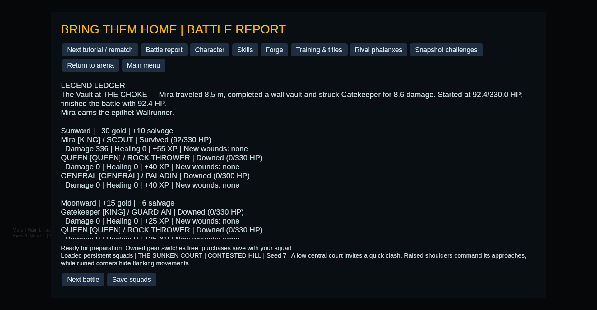

# v07: composed movement becomes witnessed history

**Staged mechanics demonstration, not a natural rescue or combat-performance
study.** A trained, wounded Scout autonomously finds and executes
`RUN → WALL VAULT → RUN → STRIKE` across a blocking wall. The actual hit earns
a persistent ledger entry and a cosmetic epithet.



## Setup and limits

The [shared fixture](../../../tests/support/opportunity.rs) grants Mira
rank-one Acrobatics, Wall dance, a remembered contact behind the wall, a missing
arm and 28% starting health. The other four roster members start downed. The
Guardian can move and defend; its attack cooldown is held high. No hit,
successful defence, critical or legend is forced. The normal planner, motion,
collision and Theus strike resolution run.

This setup isolates traversal and receipt attribution. It does not establish
that a fighter will discover the same act in an ordinary campaign, that a rescue
occurred, or that composition improves survival or win rate. It is not a human
playtest. The screenshot reloads the resulting campaign into the actual report
screen, in an isolated save directory with autosave disabled.

## Observed sequence

| Witness | Simulation tick |
| --- | ---: |
| Four-primitive plan proposed from remembered contact | 0 |
| First run endpoint observed | 5 |
| Actual wall vault starts | 6 |
| Actual landing observed | 20 |
| Second run endpoint observed | 25 |
| Opportunity controller commits the strike | 35 |
| Opposed melee hit resolves and the plan completes | 37 |

The completed plan travels **8.483503 m horizontally**, sampled after physical
simulation steps. It deals **8.6070595 damage**, with attack dice `[6, 6, 5]`
against target 18 and defence dice `[4, 5, 6]` against target 6. The outcome is
an ordinary hit, with no critical. Mira starts and finishes the battle at
**92.4/330 HP**; the missing arm qualifies this first provisional detector too.
This is not an exhaustion, interception or fall receipt.

The whole fixture battle finishes at tick 328 with 130 decision records, one
composed attempt and one completion. Subsequent ordinary attacks finish the
fight; the ledger's 8.6-damage hit is distinct from total battle damage.

## Inspect the evidence

- [Initial setup and explicit limits](audit.json), [source and file hashes](manifest.json).
- [Raw decision/event trace](decisions.jsonl): search for `"event":"opportunity"`.
  Actual executed composed decisions identify their controller as `Opportunity`.
- [Final battle](battle.json): `opportunities` retains the proposed sequence,
  physical primitive completions and actual Theus strike witness.
- [Machine-readable legend](legends.json), [readable ledger](legend-ledger.md),
  [battle report](report.md) and [learning report](learning.md).
- [Campaign before](campaign-before.json) and [after](campaign-after.json):
  the earned event belongs to Mira's stable identity. The epithet grants no
  combat bonus.

The [implementation guide](../../opportunity-composition.md) and
[integration tests](../../../tests/opportunity.rs) cover interruption,
proposal-only rejection, unrelated-hit rejection, replay, save/snapshot
continuity and the absence of title bonuses. The
[development-law status](../../development-law-status.md) identifies remaining
relationship, geometry and consequence systems.

## Reproduce and verify

```bash
cargo test --locked --no-default-features --test opportunity
cargo run --locked --no-default-features --example opportunity -- \
  --seed 6 --output outputs/opportunity-reproduction
```

Choose a new output directory. The demonstration writes complete studies and
campaign snapshots there. Timestamps, generated fighter identities and measured
wall timings vary between invocations; compare the mechanical sequence and
receipts rather than expecting every output byte to match.

Verify the published bundle's bytes and the current checkout's captured source
inputs with the Python standard library, from the repository root:

```bash
python3 - <<'PY'
import hashlib, json
from pathlib import Path
root = Path('docs/results/v07')
manifest = json.loads((root / 'manifest.json').read_text())
for base, key in ((root, 'files_sha256'), (Path('.'), 'source_sha256')):
    for name, expected in manifest[key].items():
        assert hashlib.sha256((base / name).read_bytes()).hexdigest() == expected, name
print('Evidence and source hashes match')
PY
```

Later source changes require checking out this captured revision before the
source comparison can pass. These hashes establish byte continuity, not
authenticated historical claims from other players. The older
[v06 checker](../../../tools/check_ai_evidence.py) remains scoped to v06.
