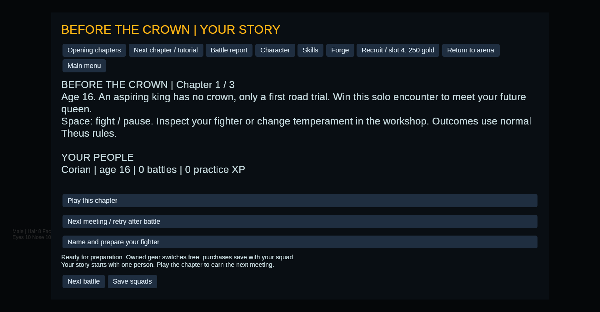
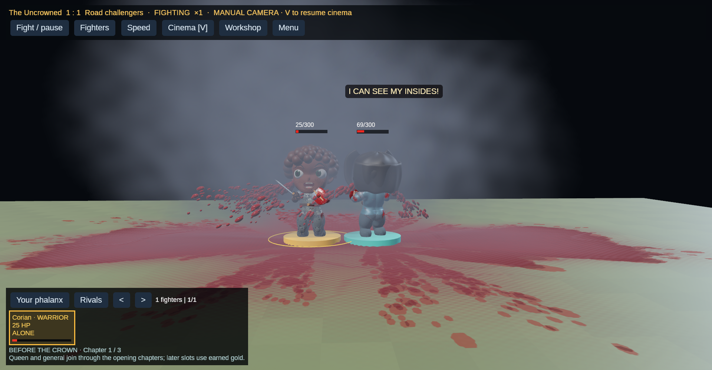

# A witnessed opening journey

This archive is one sequential, real Theus campaign journey from the new
solo/duo/trio opening. It uses the authored starting people and encounters,
normal autonomous Utility control, permanent battle-conditioned changes and
seeds 42 onward. No opponent attacks are suppressed and no victory or hit is
forced. It is a deterministic integration witness, not a balance study, player
test, comparison of AI methods or evidence of relationship-driven rescue.

| Chapter | Battle | Seed | Ticks | Actual result |
| --- | ---: | ---: | ---: | --- |
| Solo | 1 | 42 | 223 | Road challengers win |
| Solo | 2 | 43 | 243 | Player wins; queen meeting becomes available |
| Duo | 3 | 44 | 653 | Player wins; general meeting becomes available |
| Trio | 4 | 45 | 580 | Road challengers win |
| Trio | 5 | 46 | 779 | Road challengers win |
| Trio | 6 | 47 | 1062 | Draw |
| Trio | 7 | 48 | 413 | Player wins; existing campaign unlocks |

`journey/` retains the actual chapter saves, pending-win saves, victory/join
receipts and all seven studies. Each study has its initial-unit decision trace,
resolved final battle, report, persisted learning and ledger output. Legends are
not granted for chapter completion. `chapter-4.json` is the unlocked campaign;
it retains the same people. Chapter saves before a battle have no live combat
to resume: loading prepares a fresh encounter, as in normal campaign saves.





The screen above is from the AMD Vulkan graphics build. The separate runtime
combat witness starts a fresh opening, so its identities differ from the
headless journey. Seed 42 really loses; the result screen offers a retry and
shows the protagonist's learned caution and isolation memory. Its physical
death handover recorded 13 bodies, 12 joints and zero invalid poses. Visual
physics does not change the headless combat outcome.

Local validation passed: 181 headless tests, 64 graphics-side tests, strict
headless Clippy, formatting and the chapter UI control regressions. The full
journey included losses, a draw, saving pending transitions, persistent
identities/history and the existing tutorial/fourth-slot path. This does not
establish long-term balance or that players judge the animation graceful.

Reproduce:

```bash
cargo run --locked --no-default-features --example prologue_journey -- outputs/repeated-opening
cargo run --locked --bin phalanx -- --prologue-demo
```

The example uses a bounded retry budget and stops if a chapter never wins.
Repeated runs generate fresh identities, timestamps and step timings.
It writes its own output folder. The interactive demo starts paused, disables
autosaving and uses a separate manual save. See [the opening guide](../../young-king-opening.md)
for normal New Game, recruitment, migration and the adolescent rendering boundary.

`manifest.json` records the source base and SHA-256 hashes of the implementation
and archived artifacts. Source hashes identify this snapshot; later development
will change them. Individual study step timings are local observations including
recording overhead, not a benchmark or a frame-rate measurement.

Trailing blank lines in the exported Markdown learning summaries are normalized;
JSON receipts and decision traces retain their original bytes.
