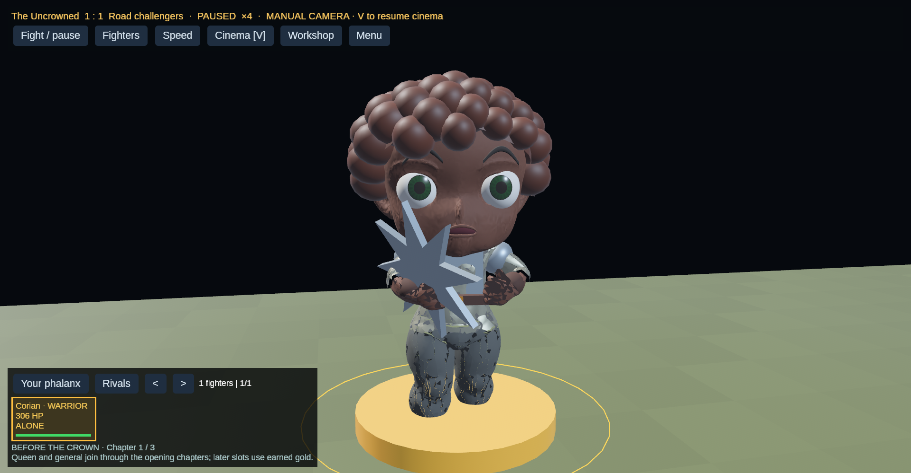
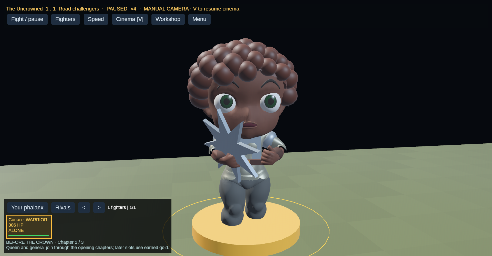
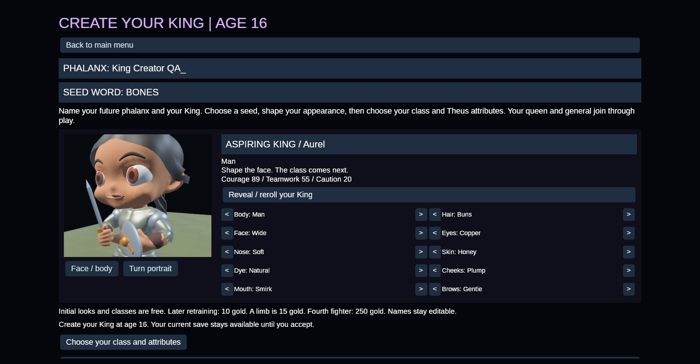
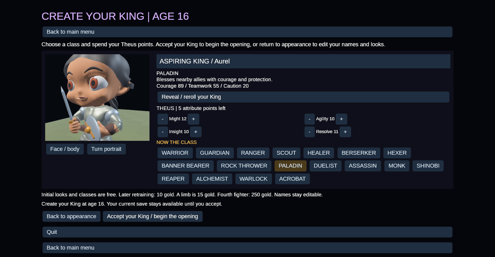

# Character surfaces and the solo King creator

The fractured surfaces had two runtime causes: rebuilding smooth normals after
splitting mesh seams, and offsetting copies of a garment seam in different
directions. These are corrected. The exported facial base and expression normals
also receive a small spatial filter to reduce noisy sculpt shading.

| Before | Repaired |
| --- | --- |
|  |  |

These local AMD/Vulkan captures use the same copied player save in a clean,
paused scene, without blood or stains. A binary comparison against `49d17b7`
confirmed that each character asset changes only its 18 facial normal accessors
and an export marker. Geometry, UVs, skeletons and animation samples are unchanged.
Clothing vertex offsets and the adolescent profile are runtime operations.

New Game now opens one adolescent King card. Appearance comes first, followed by
class and Theus attributes. Acceptance preserves the fighter identity and reserved
companions, then opens the prologue. Leaving creation preserves the existing save;
Continue resumes the draft. The classic three-founder creator remains available.

The creator captures are a scripted fixture using ordinary UI controls, named
“King Creator QA” with protagonist “Aurel.” The replay edits appearance, chooses
Paladin, adjusts an attribute, accepts and reloads its own separate save. It is
not an organic playtest. Run `cargo run --locked --bin phalanx -- --king-review`
from a disposable working directory containing an `assets` link; review output
and its save go under that directory's `outputs`.

Local checks: 187 headless tests, 67 graphics binary tests, focused prologue
validation, strict headless Clippy, formatting, character/face/motion validators
and Python analysis checks. This verifies the tested flows and captured scenes;
it does not establish visual quality for every animation or facial combination.

The graphics application holds an OS instance lock before loading assets. All
visual checks must be serial, closing and checking the previous process first.
This is covered by a lock exclusion/release test; no overlapping graphics launch
is needed to test exclusion. It is not a general memory or frame-rate benchmark.
