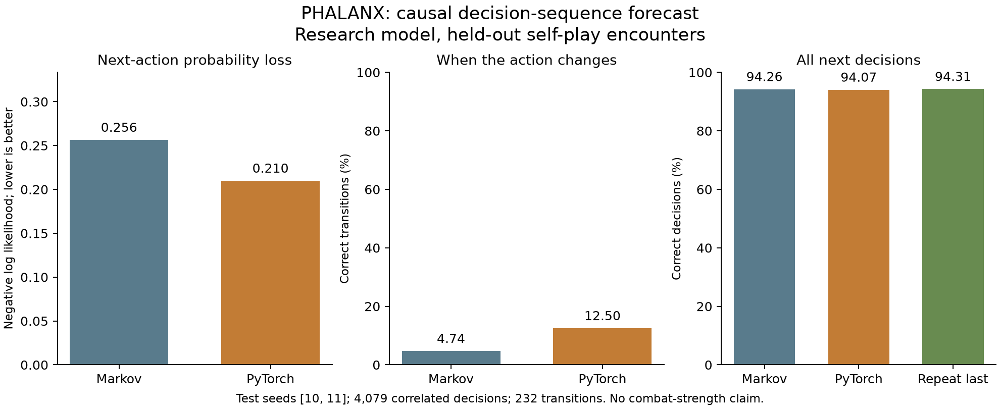

# Deep telemetry and a causal PyTorch sequence study

This change implements a deeper study feed and a separate trained research model.
The [persistent-world and learning design](../../persistent-world-and-learning.md)
records the larger direction. A persistent world, autonomous journeys, online
training and newly adaptive live opponents are not implemented by this experiment.

## Recorded experiment

The [collector](../../../examples/cognition_corpus.rs) ran 36 actual 3v3 battles:
12 seeds, three authored posture/class pairings and three existing arena families.
These are authored self-play fixtures with no starting training grants or human
player data. The player save is not opened. Starting profiles are independent;
this is not a longitudinal veteran campaign.

The corpus contains 50,653,515 JSONL bytes, 23,933 decisions, 5,579 post-step frames,
5,249 opposed Theus resolutions, 4,199 damage receipts and 532 healing receipts.
The complete collector output is roughly 57 MB. The [compressed corpus](corpus.tar.gz)
retains all battle shards and their reports; [manifest.json](manifest.json) records
artifact and source hashes. It contains no running game instance or Spark service.

The sampled technique resolutions comprise 4,599 ordinary strikes, 434 ripostes,
62 pincers, 98 Aegis launches and 56 Meteor relays. These are counts for these
fixtures, not the complete technique vocabulary or a general diversity estimate.

## Telemetry boundary

The additive v2 extension preserves the existing decision schema. Every event
has an ordered stream sequence. Headers identify the simulator build, optional
campaign battle ID and coordinate system. Actual Theus receipts retain opposed
dice, defence, critical outcomes and resolved damage.

Post-step frames capture planar positions, interval-mean velocity, terrain height,
health, effort, missing limbs, prosthetics, practice and technique/wind-up state.
They are sampled every five ticks (0.5 simulation seconds), plus the terminal step.
They are research truth, not agent observations, skeletal pose replay or a complete
record of subframe motion and cancelled wind-ups. World geography is not assigned:
the header explicitly retains arena-local coordinates and null world context.

Frames flush while recording; interrupted studies remain incomplete. Tests compare
recorded and unrecorded combat for exact final-state equality and compare streamed
Theus receipts with actual resolutions. The post-battle screen links its current
study report when that recording is available.

## What PyTorch learned and how it was evaluated

The [forecaster](../../../analysis/cognition.py) receives two preceding observations
and executed actions from the same actor. It predicts the next decision. Current
target observations, future eligibility masks, utility scores, world-truth frames,
results and rewards are excluded from input.

Whole seeds and fighter identities are separated: seeds 0–7 train, 8–9 validate,
10–11 test. Training-only normalization and validation negative log likelihood
select a checkpoint. The Markov baseline is a training-only transition table with
Laplace smoothing (one pseudocount per action pair). Test data are evaluated after
selection. There are 14,509
training, 4,565 validation and 4,079 held-out samples after constructing contiguous
causal histories. The small MLP has 4,137 parameters, trained for 20 epochs on CPU
with two PyTorch threads. [The report](report.json) records exact runtime/configuration
and trace hashes; [forecast.pt](forecast.pt) contains the actual trained weights,
normalization, schema and selected epoch.

| Held-out metric | PyTorch | Markov | Repeat last action |
| --- | ---: | ---: | ---: |
| Negative log likelihood, lower is better | 0.2099 | 0.2565 | — |
| Brier score, lower is better | 0.0962 | 0.1043 | — |
| Accuracy | 94.07% | 94.26% | 94.31% |
| Supported-class macro F1 | 0.532 | 0.544 | — |
| Accuracy on 232 action transitions | 12.50% | 4.74% | 0% |



The neural model improves probabilistic scores over the Markov baseline and
recognizes more transitions. It does not improve overall top-choice accuracy
or macro F1. Repetition dominates this corpus, most transitions are missed, and
several actions have no held-out support. This is a limited result across two
held-out seeds/six battles; correlated ticks are not independent trials. There
is no claim of stronger combat, calibrated certainty or general human modelling.
The [PDF figure](forecast.pdf) is available for inspection/export.

## Admission and next experiment

The checkpoint has no live-game authority. It uses the decision maker's own prior
observations. Using those private features to predict an opponent in live combat
would violate the observation boundary. The next dataset must record what an
opponent actually observes. A candidate tactical policy also needs legality,
runtime-cost and combat-benefit evaluation against current/historical opponents.
Neither forecasting loss nor a larger network establishes a challenging game.

No match-result progression rule changes here. Equal completion credit, actual
practice, event memories and unchanged automatic temperament policy remain intact.
No neural training runs on the gameplay thread. No new graphics process was
launched for this work.

## Reproduce

```bash
mkdir -p outputs
cargo run --locked --no-default-features --example cognition_corpus -- outputs/my-cognition-corpus 12
.venv/bin/python -m analysis.cognition --data outputs/my-cognition-corpus --output outputs/my-cognition-model --train-end 8 --val-end 10 --epochs 20
.venv/bin/python -m analysis.cognition_plot outputs/my-cognition-model/report.json outputs/my-cognition-figure
```

Use fresh output directories. To reuse this exact dataset, extract `corpus.tar.gz`
into a fresh directory and pass that directory as `--data`. The loader verifies
completion, stream continuity, causal times, schema/build consistency, eligibility,
seed/identity separation and explicit local byte/sample budgets. File hashes bind
this publication's corpus; they are not signatures authenticating remote histories.

Local validation: 188 headless tests, 67 graphics binary tests, three cognition
pipeline tests, ten existing analysis tests, strict headless Clippy and formatting.
CI also exercises a small real-corpus-to-PyTorch smoke alongside focused tests.
