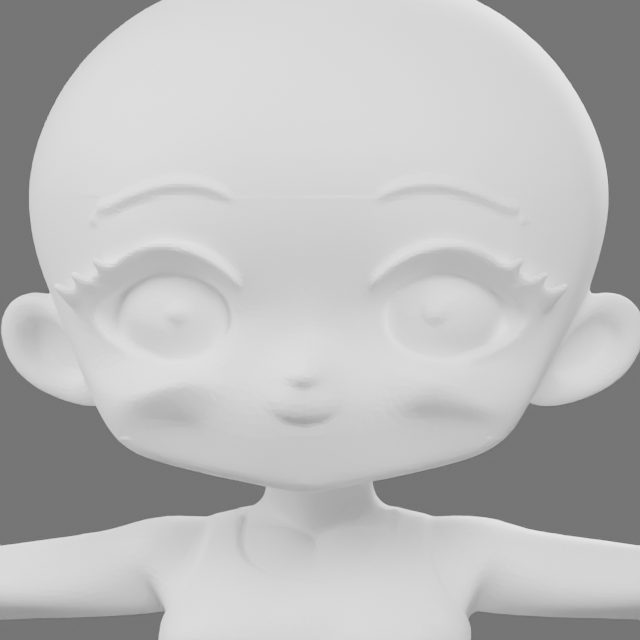
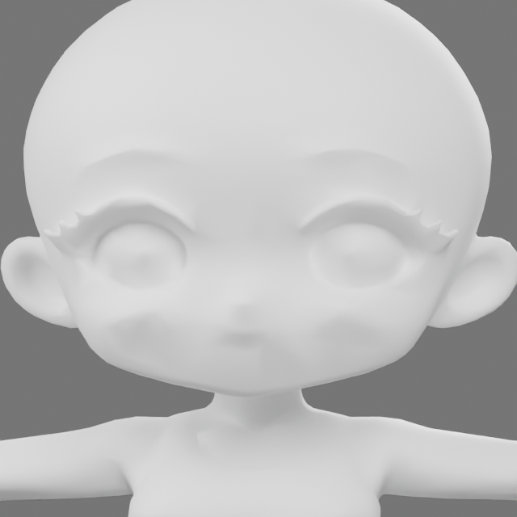
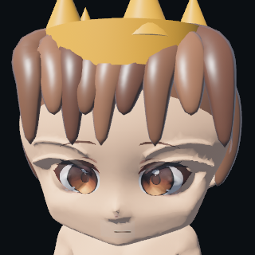

# Character and veteran combat slice

The artist's original GLBs remain in `assets/`; the renderer uses derived `assets/characters/male.glb` and `female.glb`. The original collision GLBs are preserved but do not replace the simulation's navigation/clearance rules.

## Models and animation

The male source had a Mixamo-named skeleton and no clips; the female had neither. The female export used disconnected per-triangle vertices. Welding coincident vertices before smoothing/decimation is essential: decimating that disconnected input punches holes instead of reducing a joined surface.

The derived female has a localized cheek smoothing and 5.5% weighted lateral reduction below the eyes, followed by a 19% triangle-budget reduction and nearest-surface weight transfer from the matching male T-pose. The male's existing weights are retained. Source files are untouched. This is a starter rig, not a professionally corrected anatomical skinning pass.




Both exports contain **Idle, Walk, Run, Attack, Throw, Hit and Death**. Procedurally authored Blender bone keys are in-place; movement comes from Battle, and animation time follows speed/pause. Attack cooldown changes trigger gestures; actual HP changes trigger hit/death. Corpses remain visible. Foot IK, terrain-adaptive stepping, contact-perfect throws and full ragdolls remain unfinished.

Rebuild with Blender's Python and `bpy`:

```sh
python tools/prepare_combat_characters.py
python tools/validate_character_assets.py
```

The asset checker validates actual geometry, normalized weights, valid joints, nondegenerate triangles and all seven animation channels. Current exports: female 6,967 vertices / 9,494 triangles; male 26,287 vertices / 30,868 triangles.

## Appearance

Ten user-supplied PNGs are preserved unchanged in `assets/customization/`. Six hairstyles, sixteen face cells, fifteen eye pairs and sixteen nose cells are selectable, with zero meaning no cosmetic override. The mouth sheet is preserved for a later control.

Faces are baked into cached 512×512 skin textures and projected onto the skinned body. The eye layer replaces the face sheet’s eye features rather than drawing over a second complete face. Triangle-local UV seams prevent cheek interpolation from stretching the paint. Facial textures provide starter neutral, shouting, wounded and incapacitated expressions; these are painted expressions, not a facial blendshape rig. Feature registration and source-mesh shading still need art polish.

Hair is now actual **volumetric 3D geometry** attached to the animated head. `tools/build_hair_meshes.py` generates six starter interpretations of the supplied reference silhouettes; editable `.blend` sources and `.glb` exports are in `assets/characters/hair/`. These chunky starter styles are approximations, not exact 3D reconstructions or finished hair with physics.



The inspector portrait is a second camera photographing the **same on-field model**, including its current hair, paint, crown, pose and equipment. It does not substitute a drawing or a duplicate cosmetic preview. Every Founder can use either body regardless of title; choices persist by fighter identity.

RMB orbits, MMB or Shift+RMB pans, wheel zooms, F follows the selected fighter at close range, and Home restores arena framing. Camera controls remain active while combat is paused. Escape opens the menu.

## Blood, limbs and prosthetics

Real mesh triangles supply detached arm, leg and head pieces. Nonfatal Founders wounds remove the affected organic section; the fighter keeps acting with the persistent penalties documented in [progression](progression.md). Fatal decapitation/additional dismemberment is presentation only. Flying pieces tumble under simple gravity and terrain collision; these are rigid visual pieces, not articulated ragdolls. Cutting uses authored position bands with approximate open seams, not arbitrary plane-cut surgery or watertight capped stumps.

Blood emits on real damage, with larger death bursts and a short continuing spray. Particles use substepped gravity, drag, arena-edge and wall response, terrain impacts and bouncing larger debris. Wet flattened puddles expand and orient to the terrain slope. This remains bounded presentation physics, not a fluid solver. Lobes and loops suggest spilled organs/guts; this is stylized gore, not an anatomical organ simulation. There are at most **1,536 particle instances and 128 detached pieces**. Resets clear presentation debris; effects do not change collision, pathfinding or utility scores.

Iron I prosthetics attach to the animated limb bones. The first crafting recipe, salvage flow and 3× damage / 15% movement tradeoff are real Founders mechanics. Higher tiers, crafting stations and the reserve roster are proposals.

## Arena pass

Earth/grass variation, shrubs inside authored cover, ruin stones inside existing blocked footprints and stone wall battlements improve the arena presets. Three additional large maps are Highlands (rolling high ground), Ruins (split barricade corridors), and Grand Arena (60×48, multiple choke lanes). Citadel retains its raised decks, ramps, railings and support pillars. Decorative solid rubble does not add hidden walkable-space obstacles. There is still one navigable elevation per horizontal position; true stacked underpasses remain unfinished.

## Evidence

A live graphics witness completed combat with all seven clip states observed, blood active, detached limbs present and wounded units still alive. It used 40 loaded male/female animation players, with only the chosen body visible per unit. Run a separate QA copy of the save if testing Founders rewards:

```sh
cargo run --bin phalanx -- --lab --arena ridge --visual-witness
```

This mode runs offscreen, starts at 4× speed, saves the actual portrait to `outputs/portrait-witness.png`, prints a `VISUAL_WITNESS` JSON record and exits after completion or a 40-second limit. It reports observations; inspect the record rather than treating process exit alone as proof of every effect.

The standard Lab does not acquire persistent wounds or salvage, so its published matched-seed studies remain historical baseline evidence. The frozen learned policy has not been trained on the new Founders injury/equipment distribution.

## Barks and AI boundaries

Comic text bubbles react to damage, limb loss, retreat, attacks and healing, with class and personality-specific lines. At most four are visible; per-fighter cooldowns limit repetition. Their lifetime follows simulation ticks and pauses with combat. These lines are authored and event-driven, not LLM-generated. Optional future LLM flavor should use real event context, generate between battles, cache results and retain authored fallbacks; it must not determine combat truth.
