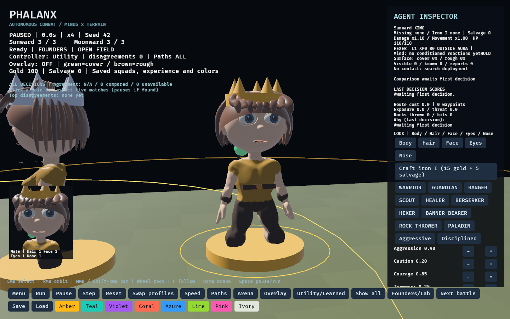

# Character and veteran combat slice

## Current models

The runtime now uses the artist's new rigged male and female bases with fitted
independent eyes. Originals remain in `assets/characters/phalanx_base_male.glb`
and `phalanx_female_base.glb`; edited `male-eyed.blend` / `female-eyed.blend`
and matching GLBs preserve the original rig and skin weights, adding eye bones.
`male.glb` / `female.glb` are the derived animated game exports. Older body
sources and experimental replacement heads/face parts have been deleted.

```sh
blender -b --python tools/fit_rigged_eyes.py
blender -b --python tools/rig_character_faces.py
blender -b --python tools/prepare_combat_characters.py
python tools/validate_character_assets.py
python tools/validate_face_assets.py
```

The preparation step normalizes centered bases to feet-at-zero coordinates
and bakes fifteen clips in stable order: the original Idle, Walk, Run, Attack,
Throw, Hit and Death, plus AttackQuick, AttackHeavy, AttackDesperate,
ThrowUnderhand, HitHeavy, LimbRecoil, DeathBackward and DeathDelayed.
Both sexes retain their own artist-authored skin weights; no weight transfer
from the older male or decimation of the female is performed.

## Appearance and facial rig

`tools/rig_character_faces.py` separates each artist-authored head along existing
triangles, opens the existing lip seam and adds a mouth interior, teeth, tongue,
lip rim, ink-like brows and spherical eyelid shells. It does not replace the
head with primitive geometry. The original source GLBs and eyed Blends remain
unchanged. Editable sources are `male-facial-rig.blend` / `female-facial-rig.blend`.

Six live controls provide rage, asymmetric pain, fear, grin/laughter, shout and
blink. Four smaller controls provide nose length/width, jaw width and cheek
variation. Eye bones carry the real eyeballs and curved irises. Faces and skin
materials update after body animation, before transform propagation; combat
clips contain no morph-weight channels that could overwrite those controls.
Damage, attack cooldown, retreat, low health, victory and barks drive the poses.
Time freezes on pause and advances when stepping. Expressions are presentation
only and do not consume the combat RNG.

Eight skin tones, six hair dyes plus automatic black/copper, five iris colours,
six volumetric hair styles and subtle face/nose variations are available. Skin
and Dye buttons save by fighter identity, alongside existing appearance choices;
older saves default the new fields. The portrait photographs the actual fighter.
Warrior steel, Guardian blue steel, Ranger green, Scout dark leather, Healer
ivory, Berserker red, Hexer purple and Banner Bearer ochre distinguish the eight
core classes. Rock Thrower keeps earth tones and Paladin gold. Team colour is
retained as an accent; class weapons and heavy-class shoulder plates remain.

These are a first 3D interpretation of the supplied comic sheets, not a faithful
finished reconstruction. Wide mouth poses and the neck transition still need
sculpt/retopology polish; hair remains a chunky procedural starter asset.

WASD pans relative to camera orientation, Shift moves faster, Q/E orbits, RMB
orbits, MMB or Shift+RMB pans and the wheel zooms. Manual movement exits follow.
F follows the selected fighter, Home restores arena framing. Controls work while
paused. J now cycles filtered disagreements, freeing D for camera movement.

## Blood, limbs and prosthetics

Real mesh triangles supply detached arm, leg and head pieces. Nonfatal Founders wounds remove the affected organic section; the fighter keeps acting with the persistent penalties documented in [progression](progression.md). Fatal decapitation/additional dismemberment is presentation only. Flying pieces tumble under simple gravity and terrain collision; these are rigid visual pieces, not articulated ragdolls. Cutting uses authored position bands with approximate open seams, not arbitrary plane-cut surgery or watertight capped stumps.

Blood emits on real damage, with larger death bursts and a short continuing spray. Particles use substepped gravity, drag, arena-edge and wall response, terrain impacts and bouncing larger debris. Wet flattened puddles expand and orient to the terrain slope. This remains bounded presentation physics, not a fluid solver. Lobes and loops suggest spilled organs/guts; this is stylized gore, not an anatomical organ simulation. There are at most **1,536 particle instances and 128 detached pieces**. Resets clear presentation debris; effects do not change collision, pathfinding or utility scores.

Iron I prosthetics attach to the animated limb bones. The first crafting recipe, salvage flow and 3× damage / 15% movement tradeoff are real Founders mechanics. Higher tiers, crafting stations and the reserve roster are proposals.

## Arena pass

Earth/grass variation, shrubs inside authored cover, ruin stones inside existing blocked footprints and stone wall battlements improve the arena presets. Three additional large maps are Highlands (rolling high ground), Ruins (split barricade corridors), and Grand Arena (60×48, multiple choke lanes). Citadel retains its raised decks, ramps, railings and support pillars. Decorative solid rubble does not add hidden walkable-space obstacles. There is still one navigable elevation per horizontal position; true stacked underpasses remain unfinished.

## Evidence

The earlier facial-rig witness completed combat with the original seven clip states observed, blood active, detached limbs present and wounded units still alive. It used 40 loaded male/female animation players, with only the chosen body visible per unit. Run a separate QA copy of the save if testing Founders rewards:

```sh
cargo run --bin phalanx -- --lab --arena ridge --visual-witness
```

This mode runs offscreen, starts at 4× speed, saves the actual portrait to `outputs/portrait-witness.png`, prints a `VISUAL_WITNESS` JSON record and exits after completion or a 40-second limit. It reports observations; inspect the record rather than treating process exit alone as proof of every effect.

The standard Lab does not acquire persistent wounds or salvage, so its published matched-seed studies remain historical baseline evidence. The frozen learned policy has not been trained on the new Founders injury/equipment distribution.

## Barks and AI boundaries

Comic text bubbles react to damage, limb loss, retreat, attacks and healing, with class and personality-specific lines. At most four are visible; per-fighter cooldowns limit repetition. Their lifetime follows simulation ticks and pauses with combat. These lines are authored and event-driven, not LLM-generated. Optional future LLM flavor should use real event context, generate between battles, cache results and retain authored fallbacks; it must not determine combat truth.

## Sound

A local seeded composer generates sixteen bars of a minor-key waltz at startup, with bass, staccato chords, a varying melody, sustained brass-like harmonies and downbeat drums. It loops at a modest level beneath combat. Twenty-four synthesized effects cover swings, impacts, cutting, blood spray, slurps, blops, gurgles, splats, throws and blessing, plus male/female pain, fear, victory and screams. Voice choice follows the selected 3D body; barks continue to supply words. These are original synthetic placeholders, including vocal-like oscillators rather than recorded human screams. They need listening and mix/art direction; they are not production foley.

Effects follow real HP loss, wounds, cooldown changes and projectile hits. The mixer admits at most four new voices per frame and sixteen active effects. Effects pause with combat; music remains available in the menu. F8 toggles music, F9 toggles effects, and the menu exposes both controls. Preferences save locally in `outputs/audio-settings.json`. Visual witnesses stay silent unless `--audible-witness` is supplied.

`cargo run --bin phalanx -- --audio-witness --seed 42` exports the score and twenty-four effect WAV files to `outputs/audio-witness/` without starting graphics or altering the campaign.

## Class equipment



Starter garments are extracted from each body's actual surface, expanded slightly and rendered with the same skin weights, inverse bind poses and joint entities. Tunics/chest armour and trousers/boots follow motion and remove the matching sections after limb loss. Leather bracers and belts add a shared silhouette; heavy classes have shoulder plates. Clothing color follows the phalanx color, and metallic chest materials distinguish Warrior, Guardian and Paladin. This is a starter fitted shell, not finished cloth topology or simulated fabric.

Weapons attach to animated hand bones and change immediately with class: Warrior sword/shield; Guardian mace/shield; Ranger bow; Scout two daggers; Healer staff; Berserker axe; Hexer orb staff; Banner Bearer pennant lance; Rock Thrower sling; Paladin hammer/shield. They visualize existing class mechanics and do not add hidden item bonuses, projectile physics or contact-perfect weapon collisions.

The user-provided [character reference sheets](art-direction/README.md) now define the art target. The 3D faces, hair and equipment are still starter interpretations. Facial poses now deform the actual new sculpts; the deleted prototype heads are not used.

## Animation validation

The asset validator checks changing animation samples, not just clip names.
The live witness also measures actual joint rotation separately for male and
female, and counts replayed gestures. Older screenshots and witness records
show earlier models and are historical evidence, not previews of the new bases.

## Combat motion variants

The additional clips are authored bone keyframes on the new male and female
rigs, not downloaded mocap or renamed copies of one motion. Editable action
libraries are saved as `assets/characters/male-combat.blend` and
`female-combat.blend`. Hand motion still lacks contact/foot IK and physical
weapon contact; these are stylized in-place gestures, not finished stunt work.

Class, discipline, courage, patience, health and attack ordinal select attack
variants without consuming battle RNG. Scouts favor quick strikes; heavy
classes favor wind-ups; wounded fighters can flail desperately. Throws have
overhand/underhand choices. Limb loss and large hits interrupt attacks, while
a simultaneous light hit allows the strike to remain visible. Repeated gestures
restart; death clips play once and hold. Front collapse, backward fall and a
delayed side topple vary deterministically with fighter identity and battle seed.
Simulation damage and its timing remain authoritative; visual wind-up is not
a new hit-frame or projectile-contact mechanic.

For isolated art review, set `PHALANX_ANIMATION=AttackHeavy` and
`PHALANX_ANIMATION_TIME=0.48` with `--visual-witness --face-witness`. This forces
a review pose, so it must not be reported as evidence of normal clip selection.

External options: [Mixamo](https://www.mixamo.com/) and the
[ActorCore free selection](https://actorcore.reallusion.com/3d-motion/free?motionTech=Mocap&saleType=Items).
This pass contains no assets downloaded from either service.

The local [combat-motion witness](results/v05/combat-motion-witness.json)
observed fourteen of fifteen clips during a completed battle, including both
sexes moving and all three death variants. HitHeavy was checked with a forced
review pose; that battle did not produce a hit above its 16% health threshold.

The RPG character-sheet preview reuses the actual body masking, armor, equipment, flag and fitted iron-limb renderers from saved member state. Unfitted missing limbs remain absent. Blood bursts now emit ten times the previous counts, within an 8,192-droplet pool, with larger splats/pools and wound trails every 0.1 simulated seconds. See [RPG workshop](rpg-workshop.md).
